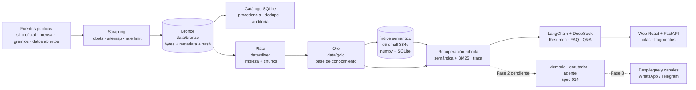
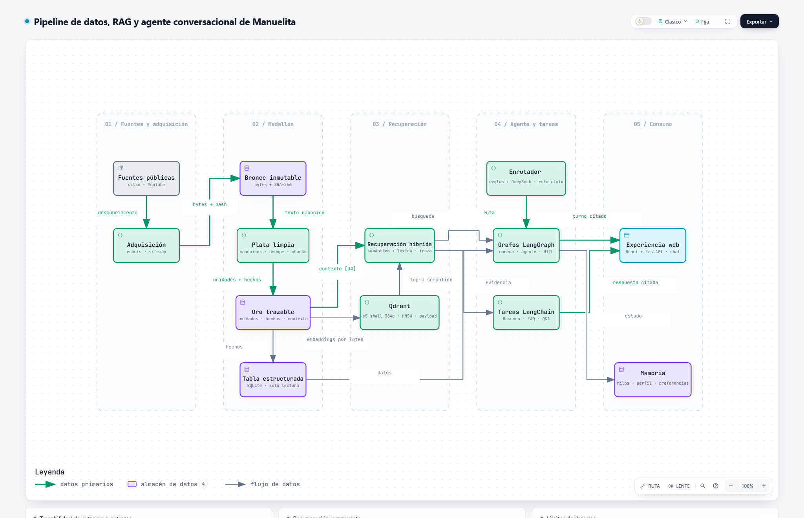
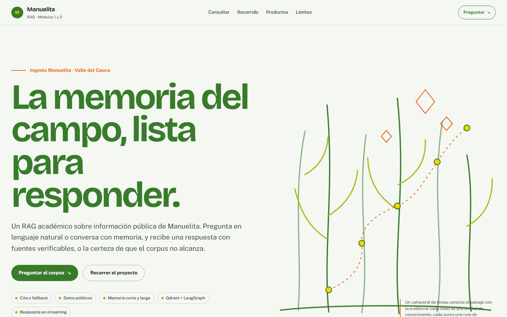

# RAG Ingenio Manuelita — Sistema Q&A

[](https://www.python.org/)
[](https://docs.astral.sh/uv/)
[](LICENSE)
[](tests/)
[](https://github.com/jasonCastano/proyecto_modelos_lenguaje/actions/workflows/ci.yml)
[](CONSTITUTION.md)

Sistema de preguntas y respuestas (Q&A) construido sobre información pública de **Ingenio Manuelita S.A.**,
empresa agroindustrial del Valle del Cauca, Colombia. El proyecto evoluciona desde una base de conocimiento
con Prompt Engineering (Módulo 1) hacia un agente RAG con memoria y enrutador (Módulo 2), y finalmente un
producto desplegado en canales reales (Módulo 3).

El Proyecto Integrador se evalúa en tres fases con pesos **30 % · 30 % · 40 %**: **Fase 1** ingesta y base
semántica; **Fase 2** agente con memoria y enrutador (base vectorial/RAG, memoria multi-turno y enrutamiento
documental vs. estructurado SQL/CSV); **Fase 3** productización y despliegue (FastAPI / Agent OS, persistencia de
estado y canales como WhatsApp o Telegram). Las reglas de cada fase viven en [`CONSTITUTION.md`](CONSTITUTION.md).

**Curso**: Técnicas Avanzadas de IA aplicadas en Modelos de Lenguaje — Maestría en IA y Ciencia de Datos,
Universidad Autónoma de Occidente, 2026-2S.

**Equipo**: Jason Alejandro Castaño · Roberto José Guerrero.

**Docente**: Jan Polanco Velasco.

**Repositorio**: https://github.com/jasonCastano/proyecto_modelos_lenguaje

> **Estado actual (constitución v1.3.0, 2026-11-07)**: las capas bronce, plata y oro, la experiencia web
> (React + FastAPI) y las tareas LangChain están operativas. La recuperación semántica e híbrida del Módulo 2
> (spec 013, PR #34) está fusionada. Para cerrar la Fase 1 faltan la ejecución real de la evaluación de
> 40 preguntas, los resultados del informe, el ensayo de la demo y el tag `v0.1.0-modulo1`. La memoria, el
> enrutador y el agente (spec 014) están especificados y pendientes de implementación.

---

## Tabla de contenido

- [Problema](#problema)
- [Solución](#solución)
- [Arquitectura](#arquitectura)
- [Arquitectura interactiva (Archify)](#arquitectura-interactiva-archify)
- [Capturas](#capturas)
- [Estado del proyecto](#estado-del-proyecto)
- [Fuentes de datos](#fuentes-de-datos)
- [Stack técnico](#stack-técnico)
- [Requisitos e instalación](#requisitos-e-instalación)
- [Uso](#uso)
- [Comandos rápidos](#comandos-rápidos)
- [Capas de datos](#capas-de-datos)
- [Estructura del repositorio](#estructura-del-repositorio)
- [Calidad y reproducibilidad](#calidad-y-reproducibilidad)
- [Gobernanza y contribución](#gobernanza-y-contribución)
- [Ética, privacidad y legalidad](#ética-privacidad-y-legalidad)
- [Limitaciones conocidas](#limitaciones-conocidas)
- [Documentación](#documentación)
- [Roadmap](#roadmap)
- [Créditos](#créditos)
- [Licencia](#licencia)
- [Cómo citar](#cómo-citar)

---

## Problema

Un cliente que se acerca por primera vez a Ingenio Manuelita necesita respuestas rápidas y confiables sobre
identidad, historia, sedes, productos, certificaciones, sostenibilidad, noticias, vacantes y datos corporativos.
Esa información está dispersa en el sitio oficial, medios, redes sociales y portales públicos, y un asistente
genérico puede responder con datos desactualizados o inventados.

**Necesidad**: un canal de comunicación automatizado, preciso y trazable que responda únicamente con información
pública verificable de la empresa y cite la fuente de cada afirmación.

## Solución

Construir una base de conocimiento semántico y un sistema Q&A/RAG con estas características:

- **Recolección reproducible** de fuentes públicas con `scrapling`, respetando `robots.txt`, `sitemap.xml`,
  `User-Agent`, timeout y límites de tasa.
- **Arquitectura medallion**: bronce (crudo), plata (limpio/chunks) y oro (base de conocimiento).
- **Procedencia completa**: URL, título, fecha UTC, hash SHA-256, fuente, tipo, idioma y categoría.
- **Q&A anclado al contexto**: el modelo responde solo con el contexto recuperado, cita fuentes y declara cuando
  no tiene evidencia.
- **Recuperación semántica e híbrida** (Módulo 2): embeddings `multilingual-e5-small` en local, índice
  `numpy` + SQLite reconstruible y fusión con la búsqueda léxica BM25, con traza visible en la API y la interfaz.
- **Evaluación empírica**: 40 preguntas (20 núcleo + 20 extendidas), comparación de prompts y análisis de errores;
  en el Módulo 2, Recall@k/MRR sobre consultas etiquetadas.
- **Interfaz web propia** con hero editorial, consola RAG, fuentes citadas y modo demostración.
- **Página del Módulo 1** que explica datos, arquitectura, prompts, app, métricas y límites.
- **Verificación E2E** con Playwright y matriz responsive.

## Arquitectura



**Decisiones clave**:

- El bronce es **inmutable**: los bytes originales se conservan con hash; la limpieza ocurre en plata/oro.
- El catálogo SQLite es la fuente de verdad para procedencia, deduplicación, versiones, cobertura y auditoría.
- El contenido retirado se mueve a `data/quarantine/` con auditoría y ventana de reversibilidad.
- El dominio oficial `manuelita.com` nunca se elimina del corpus activo.
- El índice semántico es una **vista derivada** del oro: se reconstruye con un comando y no se versiona; su
  manifiesto (modelo, fragmentación, fecha y hash del oro) sí. Cambiar el modelo de embeddings obliga a reindexar.
- La app es de **solo lectura**: no escribe en `data/` ni en el repositorio.

### Arquitectura interactiva (Archify)

El pipeline completo se puede explorar como un diagrama interactivo autocontenido: pan/zoom, temas
claro/oscuro, búsqueda y trazabilidad de relaciones. La fuente tipada es
[`docs/arquitectura.json`](docs/arquitectura.json) y el HTML se genera con Archify; no se edita a mano.

[](docs/arquitectura.html)

Regenerar y validar (con la skill Archify instalada):

```bash
node ~/.agents/skills/archify/bin/archify.mjs finalize dataflow \
  docs/arquitectura.json docs/arquitectura.html \
  --repo-root . --quality showcase --json
```

Si la copia global de la skill está incompleta, clona
[`tt-a1i/archify`](https://github.com/tt-a1i/archify) y usa `archify/bin/archify.mjs`.

El diagrama recorre **fuentes públicas → adquisición → bronce → plata → oro → índice semántico, recuperación
híbrida y tabla estructurada → enrutador y grafos LangGraph (cadena, agente, HITL) → experiencia web y memoria**.

## Capturas



La captura corresponde a la página real en 1440×900. La validación E2E se ejecuta con `make e2e` y no se
versionan capturas temporales de la auditoría.

## Estado del proyecto

| Componente | Estado | Evidencia |
|------------|--------|-----------|
| Repositorio público | ✅ | GitHub `jasonCastano/proyecto_modelos_lenguaje` |
| Licencia MIT | ✅ | `LICENSE` 2026 |
| Pipeline bronce | ✅ | 26.905 artefactos, 26.905 hashes únicos |
| Corpus activo | ✅ | 557 artefactos: 397 oficiales + 111 YouTube + 41 Fundación + 8 de terceros |
| Cobertura del sitio oficial | ✅ | 249/250 páginas del sitemap (99,6%) |
| Canales oficiales | ✅ | YouTube y Fundación capturados; Instagram y Linktree bloqueados por `robots.txt` (`docs/fuentes_oficiales.md`) |
| Capa plata | ✅ | 404 documentos canónicos, 3.810 fragmentos, 92 alias; `data/silver/` |
| Capa oro | ✅ | 15.211 unidades, 381 hechos, 38 conflictos, 24/24 ítems; `data/gold/` |
| Deduplicación y versionado | ✅ | `content_hash`, `url_versions` + MinHash/LSH en plata y Jaccard en oro |
| Reanudación e idempotencia | ✅ | Pruebas de integración de bronce, plata y oro |
| Cuarentena y auditoría | ✅ | 26.347 artefactos retirados, 26.347 auditorías |
| Pruebas | ✅ | 408 pruebas offline (391 Python + 17 web) |
| Calidad de código | ✅ | Ruff limpio |
| Modelo y entorno | ✅ | DeepSeek por API, `config/llm.toml`, modo demo offline |
| App web + LangChain | ✅ | Frontend React + API FastAPI; hero, consola RAG y showcase del Módulo 1 |
| Auditoría E2E | ✅ | Playwright: 360–1920 px, demo, fallback y foco; `make e2e` |
| Evaluación de 40 preguntas | 🟡 | Herramienta lista (`module1_eval`); falta la ejecución real y la calificación humana |
| Informe del Módulo 1 | 🟡 | Borrador en `docs/informe_modulo1.md`; resultados pendientes de M1-08 |
| Tag `v0.1.0-modulo1` | 🟡 | Pendiente de cerrar la puerta de la Fase 1 |
| Módulo 2 — recuperación semántica (spec 013) | ✅ | PR #34 fusionado; `docs/evaluacion_modulo2.md` (ver hallazgos en `docs/revision_pr34.md`) |
| Módulo 2 — memoria, enrutador y agente (spec 014) | ✅ | Cadena y agente con memoria por hilo, enrutador 35/36, HITL y preferencias; PRs #44–#50; `docs/informe_modulo2.md` |
| Módulo 2 — Recall@10, nDCG@10 y abstención fuera de corpus | ✅ | Semántico/híbrido > léxico; abstención 4/4 por el enrutador; `docs/evaluacion_modulo2.md` |
| Módulo 2 — repreguntas (SC-006) y fidelidad del juez | 🟡 | Métrica estricta 3/6 (cadena) y 4/6 (agente); fidelidad pendiente de repetir con el juez corregido |
| Tag `v0.2.0-modulo2` | 🟡 | Tras la aprobación del PR de cierre |
| CI y Pull Requests | ✅ | 38 PRs fusionados; CI verde |
| Protección de `main` | ✅ | PR con 1 aprobación y checks `test` y `web`; sin push directo ni force-push |
| Gobernanza del repositorio | ✅ | PR/issue templates, labels, Dependabot, pre-commit y Makefile |
| Cobertura de los 24 ítems | ✅ | 24/24 evaluados por la capa oro con evidencia |

### Cifras actuales

| Métrica | Valor |
|---------|------:|
| Artefactos adquiridos | 26.905 |
| Artefactos activos | 557 |
| Artefactos en cuarentena | 26.347 |
| Videos de YouTube con transcripción | 33 |
| Documentos plata canónicos | 404 |
| Fragmentos plata | 3.810 |
| Unidades oro | 15.211 |
| Hechos oro | 381 |
| Conflictos oro | 38 |
| Cobertura oro | 24/24 ítems |
| Bronze activo | 0,36 GB |
| Plata | 0,03 GB |
| Oro | 0,20 GB |
| Cuarentena | 8,93 GB |
| Datos totales | 9,52 GB (límite: 10 GB) |
| Pruebas offline | 408 |

## Fuentes de datos

| Fuente | Artefactos activos | Uso |
|--------|-------------------:|-----|
| Sitio oficial `manuelita.com` | 397 | Identidad, historia, productos, sostenibilidad, noticias, informes, vacantes |
| YouTube `@ManuelitaAgroindustria` | 111 | Metadatos del canal, 33 videos con transcripción (28 por subtítulos, 5 por ASR) y versiones de metadatos con `subtitle_kinds` |
| Fundación Manuelita | 41 | Fundación enlazada desde el Linktree oficial; informe de gestión 2025 |
| El País | 4 | Rankings y menciones empresariales |
| Cámara de Comercio de Cali | 1 | Contexto empresarial y clústeres |
| Asocañá | 1 | Contexto del sector agroindustrial |
| datos.gov.co | 2 | Patrimonio y registros territoriales con mención a Manuelita |
| Instagram | 0 | Bloqueado por `robots.txt` y por los términos de Meta |
| Linktree | 0 | Bloqueado por `robots.txt`; solo agrega enlaces ya cubiertos |
| SECOP / Supersociedades | 0 | Fuera del corpus activo por curaduría de relevancia |
| Computrabajo | 0 | Restringido por términos de servicio |

> El detalle de accesibilidad, política y vacíos de los canales oficiales está en
> [`docs/fuentes_oficiales.md`](docs/fuentes_oficiales.md). La cobertura de los 24 ítems sigue en
> revisión: la matriz por palabras clave no distingue evidencia real de falsos positivos.


## Stack técnico

| Componente | Tecnología |
|------------|------------|
| Lenguaje | Python 3.14+ |
| Entorno y dependencias | `uv`, `pyproject.toml`, `uv.lock` |
| Scraping | `scrapling[fetchers]` + `yt-dlp` |
| Extracción plata | `trafilatura` + `lxml` (HTML), `pypdf` (PDF), `openpyxl` (XLSX) |
| Transcripción local | `faster-whisper` (extra `asr`, opcional) |
| Catálogo | SQLite (WAL) + manifiestos JSONL |
| Pruebas | `pytest` |
| Lint y formato | `ruff` |
| LLM (Módulo 1) | LangChain + DeepSeek API (`deepseek-flash`) |
| Interfaz (Módulo 1) | React 19 + Vite + TypeScript; FastAPI + Uvicorn |
| Arquitectura viva | Archify (`docs/arquitectura.html`) |
| RAG (Módulo 2) | `fastembed` (ONNX) + `numpy`; índice `.npy` + SQLite |
| Desarrollo guiado por specs | Spec Kit (`.specify/`), con comandos para OpenCode y Claude Code |

## Requisitos e instalación

- Python 3.14 o superior.
- [`uv`](https://docs.astral.sh/uv/) instalado.
- Node.js 24 y npm para el frontend.
- Conexión a internet solo para campañas reales; las pruebas no la requieren.

```bash
git lfs install
git clone https://github.com/jasonCastano/proyecto_modelos_lenguaje.git
cd proyecto_modelos_lenguaje
git lfs pull
uv sync --frozen
cd web && npm ci && cd ..
make check
```

Los datos de bronce, plata y oro se descargan con Git LFS (~489 MB). La cuarentena no se versiona ni se
descarga.

## Uso

### Comandos rápidos

```bash
make help      # lista los objetivos
make dev       # uv sync + npm ci + hooks
make check     # Python + tests/build web
make app       # build web + API local
make e2e       # Playwright: flujo, responsive y demo
make build     # web + sdist + wheel
```

La experiencia corre con FastAPI en `http://127.0.0.1:8000`. Para desarrollo con recarga:

```bash
uv run uvicorn proyecto_modelos_lenguaje.api:app --reload --port 8000
cd web && npm run dev
```

El modo demostración se activa desde la propia consola y no requiere DeepSeek ni red.

### Pipeline bronce

```bash
# Entrada canónica: ayuda y campaña real o reanudación
uv run python scripts/scrape_empresa.py --help
uv run python scripts/scrape_empresa.py \
  --config config/sources.toml \
  --campaign 2026-10-baseline \
  --resume

# Prueba segura sin escribir en el bronce
uv run python scripts/scrape_empresa.py \
  --campaign 2026-10-m1-02-smoke \
  --limit 3 \
  --dry-run \
  --json

# Inicializar catálogo, fuentes y los 24 ítems
uv run pml init --config config/sources.toml --json

# Alternativa de bajo nivel: campaña real o reanudación
uv run python scripts/run_campaign.py \
  --config config/sources.toml \
  --campaign 2026-10-baseline

# Verificar integridad del corpus activo
uv run python scripts/verify_bronze.py \
  --campaign 2026-10-baseline --sample 50 --seed 1 --json

# Cobertura de los 24 ítems sobre el corpus activo
uv run pml coverage --campaign 2026-10-baseline --active-only --json

# Catálogo y exportación
uv run python scripts/query_catalog.py list --campaign 2026-10-baseline --limit 10 --json
uv run python scripts/query_catalog.py export \
  --campaign 2026-10-baseline --active-only \
  --format jsonl --output exports/curated.jsonl
```

### Canales oficiales y transcripciones

```bash
# YouTube + Linktree + Instagram (estas dos últimas se registran como bloqueadas por robots.txt)
uv run pml init --config config/official_channels.toml --json
uv run python scripts/run_campaign.py \
  --config config/official_channels.toml \
  --campaign 2026-10-official-channels-3

# Fundación Manuelita (enlazada desde el Linktree oficial)
uv run pml init --config config/fundacion_manuelita.toml --json
uv run python scripts/run_campaign.py \
  --config config/fundacion_manuelita.toml \
  --campaign 2026-10-fundacion-manuelita

# Reintento de subtítulos limitados por YouTube
uv run python scripts/run_campaign.py \
  --config config/youtube_backfill.toml \
  --campaign 2026-10-youtube-backfill-1

# Transcripción local de videos sin subtítulos (descarga el modelo la primera vez)
uv run --extra asr python scripts/transcribe_youtube.py \
  --url "https://www.youtube.com/watch?v=VwAvljONZd0" \
  --model small

# Auditoría de fuentes, política y transcripciones
uv run python scripts/verify_official_channels.py
```

El detalle de qué se pudo capturar en cada canal, qué quedó bloqueado y por qué está en
[`docs/fuentes_oficiales.md`](docs/fuentes_oficiales.md).

### Modelo por API (DeepSeek)

El Módulo 1 usa **DeepSeek V4.1 Flash 1017** por API. La configuración vive en `config/llm.toml`; la
clave se lee de una variable de entorno y nunca se versiona.

```bash
cp .env.example .env      # completa DEEPSEEK_API_KEY
uv run python -m proyecto_modelos_lenguaje.llm --print-config
uv run python -m proyecto_modelos_lenguaje.llm --check
```

- Modelo por defecto: `deepseek-flash` (configurable con `DEEPSEEK_MODEL`).
- URL base: `https://api.deepseek.com/v1` (configurable con `DEEPSEEK_BASE_URL`).
- Clave: `DEEPSEEK_API_KEY` en `.env`; `.env` está ignorado por Git.
- `--print-config` muestra `api_key_env` y `api_key_present`, **nunca** el valor de la clave.
- `--check` devuelve `0` si la clave es válida y el modelo existe; `2` con un mensaje accionable si falta
  la clave, la clave es inválida o el modelo no está disponible.
- Las tarifas (`cost_per_1k_input`, `cost_per_1k_output`) alimentan el costo estimado del panel; con `0.0`
  el panel indica «costo no configurado».
- Sin red o sin cuota, activa el modo demostración (`PML_DEMO=1`): respuestas de prueba, sin llamadas
  remotas.
- Las pruebas usan `build_fake_model()` y un transporte simulado: no requieren clave ni red.

### Capa plata (silver)

```bash
# Construir o actualizar la capa plata
uv run pml silver build --run 2026-10-silver-01 --json

# Humo con diez artefactos
uv run pml silver build --run 2026-10-silver-00 --limit 10 --json

# Auditoría, reporte y estado
uv run pml silver verify --run 2026-10-silver-01 --sample 50 --seed 1 --json
uv run pml silver report --run 2026-10-silver-01 --format md
uv run pml silver status --json

# Envoltorio canónico
uv run python scripts/build_silver.py --run 2026-10-silver-01 --json
```

Salidas en `data/silver/`:

```text
data/silver/
├── documents.jsonl                  # documentos canónicos y alias
├── chunks.jsonl                     # fragmentos de documentos canónicos
├── markdown/<doc_id>.md             # revisión humana con frontmatter
├── _meta/state.jsonl                # estado incremental por artefacto
└── reports/<run_id>/quality.{json,md}
```

La plata es determinista y offline: no usa LLM, embeddings ni OCR. Los PDF escaneados, cifrados o sin texto
se omiten con una razón; no se inventa contenido. La configuración está en `config/silver.toml` y su hash queda
registrado en cada ejecución.

### Capa oro (gold)

```bash
# Construir o actualizar la base consolidada
uv run pml gold build --run 2026-10-gold-01 --json

# Humo con diez documentos
uv run pml gold build --run 2026-10-gold-00 --limit 10 --json

# Auditoría, reporte y estado
uv run pml gold verify --run 2026-10-gold-01 --sample 100 --json
uv run pml gold report --run 2026-10-gold-01 --format md
uv run pml gold status --json

# Envoltorio canónico
uv run python scripts/build_gold.py --run 2026-10-gold-01 --json
```

Salidas en `data/gold/`:

```text
data/gold/
├── knowledge_units.jsonl          # unidades extractivas con evidencia
├── facts.jsonl                    # hechos numéricos/fechados
├── entities.jsonl                 # entidades canónicas y alias
├── conflicts.jsonl                # contradicciones y resolución
├── coverage.json / coverage.md    # matriz de los 24 ítems
├── faq_seeds.jsonl                # preguntas semilla para FAQ
├── context_8000.* / context_32000.*  # contexto con citas
├── topics/<topic_id>.md           # páginas de tema
├── glossary.md
├── manifest.json
└── reports/<run_id>/quality.{json,md}
```

La capa oro es extractiva y determinista: no resume, no responde, no traduce y no usa embeddings. Cada unidad
conserva su cita; los conflictos se preservan y los vacíos de cobertura se declaran.

### Tareas del Módulo 1: Resumen, FAQ y Q&A (M1-05)

Las tres tareas usan LangChain sobre la capa de oro, con recuperación léxica determinista (sin embeddings),
prompts versionados en `prompts/` y citas `[U#]` verificables. La configuración vive en `config/tasks.toml`.

```bash
# Q&A con citas y fallback explícito
uv run python -m proyecto_modelos_lenguaje.tasks qa \
  --question "¿Qué productos ofrece Manuelita?" --json

# Resumen del paquete de contexto (8.000 tokens por defecto)
uv run python -m proyecto_modelos_lenguaje.tasks summary --pack 8000 --json

# FAQ con evidencia (10 a 20 preguntas)
uv run python -m proyecto_modelos_lenguaje.tasks faq --limit 12 --json
```

- `--fake` usa un modelo falso determinista: no requiere clave ni red, ideal para CI y para revisar el flujo.
- `--config` apunta a otra configuración; `--json` emite un único objeto JSON (o una lista, en `faq`).
- Códigos de salida: `0` resultado (incluido `fallback`), `1` error controlado del modelo, `2` error de uso.
- La variable `PML_GOLD_DIR` permite apuntar a otra capa de oro (por defecto `data/gold`).
- Si el corpus no sostiene la respuesta, el resultado es `status=fallback`, `citations=[]` y el mensaje
  «No hay evidencia suficiente en el corpus para responder.»; nunca se inventa contenido.
- Guía de validación completa: [`specs/007-langchain-qa-tasks/quickstart.md`](specs/007-langchain-qa-tasks/quickstart.md).
- Decisión de arquitectura: [`docs/decisions/0007-langchain-tasks.md`](docs/decisions/0007-langchain-tasks.md).

### Recuperación semántica (Módulo 2)

El chatbot ya puede responder con **RAG**: recupera fragmentos por similitud semántica y los fusiona con la
búsqueda léxica. El modelo `intfloat/multilingual-e5-small` (384 dimensiones, 512 tokens) corre en local con
ONNX, sin costo por consulta y sin enviar el corpus a terceros.

```bash
# Construir y verificar el índice (la primera vez descarga el modelo, ~120 MB)
uv run python -m proyecto_modelos_lenguaje.rag index build
uv run python -m proyecto_modelos_lenguaje.rag index verify

# Ver qué fragmentos sustentan una respuesta, sin llamar al LLM
uv run python -m proyecto_modelos_lenguaje.rag search "¿cómo cuida Manuelita el agua?" --k 8

# Comparar semántica, léxica e híbrida y escribir el informe
uv run python -m proyecto_modelos_lenguaje.rag evaluate \
  --questions tests/fixtures/rag/eval_questions.jsonl \
  --out docs/evaluacion_modulo2.md
```

- El índice vive en `data/module2/index/` (no versionado; se reconstruye con un comando).
- Espacio requerido: ~120 MB del modelo y ~23 MB del índice de 15.211 unidades.
- Si el índice falta o no es válido, la app responde con recuperación léxica y lo declara en la traza.
- Validación completa: [`specs/013-semantic-rag-chatbot/quickstart.md`](specs/013-semantic-rag-chatbot/quickstart.md).
- Resultados: [`docs/evaluacion_modulo2.md`](docs/evaluacion_modulo2.md) · Decisión:
  [`docs/decisions/0014-semantic-rag.md`](docs/decisions/0014-semantic-rag.md).

### Curaduría de relevancia

```bash
uv run pml curate analyze --relevance-config config/relevance.toml --json
uv run pml curate analyze --relevance-config config/relevance.toml \
  --run 2026-10-curation-01 --apply --json
uv run pml curate review list --run 2026-10-curation-01 --json
uv run pml curate approve --run 2026-10-curation-01 --reviewer "tu nombre"
uv run pml curate quarantine --run 2026-10-curation-01 --confirm
uv run pml curate purge --run 2026-10-curation-01 --expired --confirm
```

### Bitácora del proyecto

```bash
uv run python .opencode/skills/bitacora/scripts/generate_bitacora.py
```

En Claude Code, la misma bitácora se invoca con `/bitacora` (skill en `.claude/skills/bitacora/`, que
reutiliza este generador).

Genera un archivo fechado en `bitacora/` con el estado de Git local/remoto, el avance, los pendientes y los
próximos pasos.

### Conversación con memoria y enrutador (Módulo 2)

El asistente conversa por hilos (`thread_id`) y decide la ruta de cada mensaje antes de buscar: saludo o fuera
de alcance sin búsqueda, documentos (RAG híbrido) o datos puntuales (tabla SQLite derivada del oro). Hay dos
variantes sobre el mismo estado: **cadena** (una búsqueda por turno) y **agente** (`create_agent` decide las
búsquedas). Toda escritura (preferencias, olvido, exportación) espera aprobación humana.

```bash
# Una vez: tabla estructurada (15 entidades, 381 hechos, 477 citas)
uv run python -m proyecto_modelos_lenguaje.agent build-structured

# Conversar (sin --thread crea un hilo y muestra su UUID)
uv run python -m proyecto_modelos_lenguaje.agent chat --mode real "¿Qué produce Manuelita?"
uv run python -m proyecto_modelos_lenguaje.agent chat --mode real --thread <UUID> "¿Y dónde lo produce?"
uv run python -m proyecto_modelos_lenguaje.agent chat --mode demo --variant agent --json "Hola"

# Evaluar el enrutador y comparar cadena vs. agente (con juez LLM)
uv run python -m proyecto_modelos_lenguaje.agent evaluate --mode real
uv run python -m proyecto_modelos_lenguaje.agent evaluate --mode real --compare --judge --skip-router
```

- Estado fuera del repositorio en `MANUELITA_STATE_DIR` (por defecto `%LOCALAPPDATA%\manuelita-rag`):
  hilos en `checkpoints.sqlite3`, preferencias en `memory.sqlite3`. Política en
  [`docs/memoria.md`](docs/memoria.md).
- API: `POST /api/chat`, `GET /api/threads/{id}`, `POST /api/threads/{id}/resume`,
  `GET|DELETE /api/memory/{user_id}` ([contrato](specs/014-rag-agent-memory-router/contracts/chat-api.md)).
- Web: pestaña **Conversación** con chip de ruta, fragmentos, fuentes, métricas por turno y tarjeta de
  aprobación.
- Trazas opcionales con LangSmith: define `LANGSMITH_TRACING=true` y `LANGSMITH_API_KEY` en `.env` (no se
  versiona). Los mensajes llegan ya sin datos personales; no la actives con usuarios reales sin revisar
  `docs/memoria.md` §6.
- Resultados: [`docs/evaluacion_modulo2.md`](docs/evaluacion_modulo2.md) · Informe:
  [`docs/informe_modulo2.md`](docs/informe_modulo2.md) · Decisión:
  [`docs/decisions/0016-rag-agent-langgraph.md`](docs/decisions/0016-rag-agent-langgraph.md).

### Experiencia web y API

La entrada actual es una página React servida por FastAPI:

```bash
make app
```

Abre `http://127.0.0.1:8000`. Para desarrollo con recarga:

```bash
uv run uvicorn proyecto_modelos_lenguaje.api:app --reload --port 8000
cd web && npm run dev
```

La página incluye:

- **Hero editorial** con la identidad “Cañaveral editorial”.
- **Consola RAG** con Consulta, Resumen y FAQ, citas `[U#]`, metadatos y fallback.
- **Showcase del Módulo 1** con problema, datos, medallion, prompts, tareas, app, métricas y límites.
- **Modo demostración** explícito, sin clave ni red.
- **Conversación** con memoria, enrutador, fragmentos, fuentes y aprobación de escrituras (Módulo 2).
- **API** en `/api/health`, `/api/ask`, `/api/summary`, `/api/faq`, `/api/showcase`, `/api/chat`,
  `/api/threads/{id}` y `/api/memory/{user_id}`.

La clave DeepSeek permanece en el servidor. La guía completa está en
[`specs/012-manuelita-rag-showcase/quickstart.md`](specs/012-manuelita-rag-showcase/quickstart.md) y la
decisión en [`docs/decisions/0013-web-frontend.md`](docs/decisions/0013-web-frontend.md).

#### Verificación E2E

```bash
make e2e
```

Playwright recorre el flujo demo, el showcase, la matriz 360–1920 px, `prefers-reduced-motion` y la
conversación (dos turnos, aprobar y rechazar, 375 px). Los tests
de API y componentes se ejecutan con `make check`.

#### Identidad visual

La interfaz adopta la identidad pública de Grupo Manuelita (spec
[`009-manuelita-visual-identity`](specs/009-manuelita-visual-identity/spec.md)): cabecera con firma
institucional, tarjetas de fuente, badges de estado y pie con atribución. La paleta se extrae del logotipo
oficial y no requiere conexión:

| Color | Valor | Uso |
|-------|-------|-----|
| Verde bosque | `#387C2B` | Primario |
| Naranja | `#E86D1F` | Acento |
| Verde lima | `#B0BC22` | Apoyo |
| Amarillo | `#FFD200` | Apoyo |
| Naranja claro | `#F6A01A` | Apoyo |

Los tokens viven en `src/proyecto_modelos_lenguaje/brand.py` y `web/src/styles/tokens.css`; el contraste
(4.5:1 / 3:1) se verifica en `tests/unit/test_brand.py` y `tests/api/test_web_tokens.py`. Es un proyecto académico: la app lo
declara y no sugiere afiliación oficial.

## Capas de datos

| Capa | Ruta | Equivalente en la rúbrica | Estado |
|------|------|---------------------------|--------|
| Bronce | `data/bronze/` | `data/raw/` | ✅ Implementada |
| Plata | `data/silver/` | `data/processed/` | ✅ Implementada |
| Oro | `data/gold/` | `data/gold/` | ✅ Implementada |
| Cuarentena | `data/quarantine/` | — | ✅ Auditoría de retiros |

```text
data/bronze/
├── raw/<fuente>/<campaña>/<sha256>.<ext>   # bytes originales
├── manifests/<campaña>.jsonl               # metadata de cada artefacto
├── reports/<campaña>/                      # reportes de campaña y cobertura
└── _meta/bronze.sqlite3                    # catálogo SQLite

data/silver/
├── documents.jsonl                         # documentos canónicos y alias
├── chunks.jsonl                            # fragmentos recuperables
├── markdown/<doc_id>.md                    # revisión con frontmatter YAML
├── _meta/state.jsonl                       # estado incremental
└── reports/<run_id>/quality.{json,md}      # calidad por ejecución
```

El límite de 10 GB se controla sobre `data/bronze/`. Bronce, plata y oro se versionan en **Git LFS**;
la cuarentena, los cachés, los smoke runs y `data/module1/` quedan fuera de Git. Los datos también se
referencian por manifiesto y hash.

## Estructura del repositorio

```text
.
├── web/                           # Frontend React + Vite + TypeScript
│   ├── src/components/            # Hero, consola RAG, showcase y motivos
│   └── src/styles/                # Tokens y composición editorial
├── src/proyecto_modelos_lenguaje/ # API FastAPI, RAG, pipeline y branding
├── bitacora/                      # Bitácoras fechadas del proyecto
├── config/                        # Fuentes, cobertura, LLM, prompts y reglas
├── data/                          # Capas medallion versionadas por Git LFS
│   ├── bronze/                    # Crudo, inmutable
│   ├── silver/                    # Texto limpio, secciones y chunks
│   ├── gold/                      # Base de conocimiento con citas
│   └── quarantine/                # Retiros con auditoría (fuera de Git)
├── docs/                          # Alcance, ficha de datos, ADRs y arquitectura
│   ├── arquitectura.json          # Fuente Archify
│   ├── arquitectura.html          # Diagrama interactivo
│   └── decisions/                 # ADRs
├── scripts/                       # Entradas operativas
├── specs/                         # Especificaciones, planes y tareas (001–014)
├── tests/                         # Unitarias, integración, contrato y E2E
├── .github/                       # PR/issue templates, CI, labels y Dependabot
├── .opencode/                     # Comandos y skill de bitácora (generador compartido)
├── .claude/skills/                # Skills de Claude Code (speckit-*, bitacora)
├── AGENTS.md                      # Contexto para asistentes LLM
├── CONSTITUTION.md                # Fuente única de verdad
├── CONTRIBUTING.md                # Guía de contribución
├── Makefile                       # Interfaz de comandos
├── LICENSE                        # MIT 2026
├── README.md
├── pyproject.toml
└── uv.lock
```

## Calidad y reproducibilidad

- **Entorno reproducible**: `uv sync --frozen`; versiones fijadas en `uv.lock`.
- **Pruebas offline**: 408 pruebas unitarias, de integración y de contrato.
- **Verificación completa**: `make check` ejecuta Ruff, pytest, Vitest y build web; CI separa Python y web.
- **Auditoría visual**: `make audit` recorre 7 perfiles y 3 estados de datos con Playwright.
- **Lint**: `uv run ruff check .` sin hallazgos.
- **Integridad**: SHA-256 por artefacto; verificación de muestras del corpus activo.
- **Procedencia**: URL canónica, fecha UTC, tipo, tamaño, categoría, idioma y campaña.
- **Deduplicación**: una copia por `content_hash`; URL alternas como alias.
- **Reanudación**: checkpoints y estados por objetivo; reintentos con backoff.
- **Auditoría**: retiros con URL, hash, motivo, puntuación y fecha.
- **Configuración versionada**: `config_hash` por campaña y por ejecución de curaduría.

```bash
uv run pytest
uv run ruff check .
uv run python scripts/verify_bronze.py --campaign 2026-10-baseline --sample 50 --seed 1 --json
```

## Gobernanza y contribución

- **Mantenedor**: Jason Alejandro Castaño — GitHub [`@jasonCastano`](https://github.com/jasonCastano),
  correo `jasonale3007@gmail.com`.
- **Repositorio**: https://github.com/jasonCastano/proyecto_modelos_lenguaje
- **Rama estable**: `main`, protegida: todo cambio entra por Pull Request con al menos una aprobación del otro
  integrante y los checks `test` y `web` en verde; el autor no aprueba su propio PR.
- **Ramas**: `feat/...`, `fix/...`, `docs/...` o `chore/...`; commits con Conventional Commits.
- **Autoría**: los commits son de `jasonCastano` o `Robertto48`, o de un bot autorizado
  (`dependabot[bot]`); los asistentes de IA no figuran como coautores. Lo verifican el hook `commit-msg` y
  el job `autoria` del CI ([`CONSTITUTION.md`](CONSTITUTION.md) §4.3).
- **Especificaciones**: cada fase tiene especificación, plan y tareas en [`specs/`](specs/), gestionados con
  Spec Kit (`/speckit-specify`, `/speckit-plan`, `/speckit-tasks`, …).
- **Entregas**: cada módulo se etiqueta (`v0.1.0-modulo1`, `v0.2.0-modulo2`) sobre un commit con CI verde.
- **Plantillas**: PR e issues en [`.github/`](.github/), con checklist de constitución y pruebas.
- **Etiquetas y Dependabot**: declaradas en [`.github/labels.yml`](.github/labels.yml) y
  [`.github/dependabot.yml`](.github/dependabot.yml).
- **Calidad local**: [`Makefile`](Makefile), [`.pre-commit-config.yaml`](.pre-commit-config.yaml) y
  [`.editorconfig`](.editorconfig).
- **Contribución**: lee [`CONTRIBUTING.md`](CONTRIBUTING.md) y el
  [código de conducta](CODE_OF_CONDUCT.md).
- **Contexto para agentes**: [`AGENTS.md`](AGENTS.md) y [`.opencode/rules/tgrep.md`](.opencode/rules/tgrep.md).
- **Constitución**: [`CONSTITUTION.md`](CONSTITUTION.md) prevalece sobre cualquier otra práctica.

## Ética, privacidad y legalidad

- Solo se recolecta información pública, sin autenticación, muros de pago ni elusión de controles.
- Se respetan `robots.txt`, `sitemap.xml`, términos de servicio, `User-Agent`, timeout y rate limit.
- No se incorporan datos personales sensibles; los nombres y cargos corporativos públicos se citan con fines
  académicos.
- El contenido de terceros pertenece a sus fuentes y se atribuye; se atienden solicitudes de retiro.
- Las respuestas del sistema no constituyen asesoría oficial de Ingenio Manuelita.
- No se versionan claves, `.env`, cuarentena ni credenciales; bronce, plata y oro van en Git LFS.
- El uso de asistentes de IA se declara; el equipo revisa, prueba y asume la responsabilidad del código,
  prompts y afirmaciones.

## Limitaciones conocidas

- El corpus activo es de 557 artefactos; 26.347 fueron retirados a cuarentena por no ser relevantes.
- La cuarentena ocupa 8,93 GB y el total de datos está en 9,52 GB; la purga definitiva está pendiente.
- La capa plata produjo 404 documentos canónicos y 3.810 fragmentos; 92 artefactos quedaron como alias por
  duplicados o versiones. 61 se omitieron: 35 sin texto, 10 PDF escaneados, 6 PDF cifrados y 10 sitemaps.
- Instagram y Linktree no se capturan por `robots.txt`; 30 videos de YouTube no están disponibles y 3 exigen sesión.
- La matriz de 24 ítems requiere recalibración: SECOP, NIT, precios, fichas técnicas y catálogos aún no tienen
  evidencia verificable.
- La capa oro produjo 15.211 unidades extractivas, 381 hechos, 15 entidades y 38 conflictos; 24/24 ítems
  evaluados. Los conflictos y la cobertura requieren revisión muestral antes de la evaluación final.
- La evaluación de 40 preguntas tiene la herramienta lista (`module1_eval`), pero falta la ejecución real con
  DeepSeek y la calificación humana; el informe y el guion de demo son borradores y faltan las capturas de
  Consulta/Resumen/FAQ.
- La recuperación semántica aún no reporta Recall@10/nDCG@10 y su umbral (0,30) no abstiene fuera de corpus
  (similitudes de 0,80–0,87); ver [`docs/revision_pr34.md`](docs/revision_pr34.md).
- Los PRs fusionados antes del 2026-11-07 no tienen aprobaciones formales en GitHub; desde entonces `main` exige
  revisión cruzada.
- No existe aún una rúbrica oficial de la Entrega 2; cuando se publique se enmiendan la constitución y las
  specs 013/014.

## Documentación

- [Constitución del proyecto](CONSTITUTION.md)
- [Ficha de datos del corpus](docs/data_card.md)
- [Alcance del Q&A y banco de 40 preguntas](docs/alcance.md)
- [Especificación del bronce](specs/001-bronze-web-scraping/spec.md)
- [Plan del bronce](specs/001-bronze-web-scraping/plan.md)
- [Especificación de curaduría](specs/002-manuelita-relevance-filter/spec.md)
- [Plan de curaduría](specs/002-manuelita-relevance-filter/plan.md)
- [Especificación de la capa plata](specs/003-silver-medallion-layer/spec.md)
- [Plan de la capa plata](specs/003-silver-medallion-layer/plan.md)
- [Guía de validación de la capa plata](specs/003-silver-medallion-layer/quickstart.md)
- [Decisión de arquitectura de la capa plata](docs/decisions/0003-silver-layer.md)
- [Especificación de la capa oro](specs/004-gold-medallion-layer/spec.md)
- [Plan de la capa oro](specs/004-gold-medallion-layer/plan.md)
- [Guía de validación de la capa oro](specs/004-gold-medallion-layer/quickstart.md)
- [Decisión de arquitectura de la capa oro](docs/decisions/0004-gold-layer.md)
- [Especificación de la entrada canónica de scraping](specs/005-scrape-empresa-entrypoint/spec.md)
- [Plan de la entrada canónica de scraping](specs/005-scrape-empresa-entrypoint/plan.md)
- [Guía de validación de la entrada canónica](specs/005-scrape-empresa-entrypoint/quickstart.md)
- [Decisión de arquitectura de la entrada canónica](docs/decisions/0005-scrape-entrypoint.md)
- [Especificación de tareas LangChain](specs/007-langchain-qa-tasks/spec.md)
- [Plan de tareas LangChain](specs/007-langchain-qa-tasks/plan.md)
- [Tareas de LangChain](specs/007-langchain-qa-tasks/tasks.md)
- [Guía de validación de tareas LangChain](specs/007-langchain-qa-tasks/quickstart.md)
- [Especificación de la app Streamlit](specs/008-streamlit-qa-app/spec.md)
- [Plan de la app Streamlit](specs/008-streamlit-qa-app/plan.md)
- [Tareas de la app Streamlit](specs/008-streamlit-qa-app/tasks.md)
- [Guía de validación de la app Streamlit](specs/008-streamlit-qa-app/quickstart.md)
- [Decisión de arquitectura de la app Streamlit](docs/decisions/0009-streamlit-app.md)
- [Especificación de identidad visual](specs/009-manuelita-visual-identity/spec.md)
- [Decisión de arquitectura de identidad visual](docs/decisions/0010-brand-identity.md)
- [Especificación del panel de Métricas](specs/010-metrics-panel-layout/spec.md)
- [Plan del panel de Métricas](specs/010-metrics-panel-layout/plan.md)
- [Tareas del panel de Métricas](specs/010-metrics-panel-layout/tasks.md)
- [Guía de validación del panel de Métricas](specs/010-metrics-panel-layout/quickstart.md)
- [Especificación del proveedor DeepSeek](specs/011-deepseek-api-model/spec.md)
- [Especificación del frontend Manuelita](specs/012-manuelita-rag-showcase/spec.md)
- [Plan del frontend Manuelita](specs/012-manuelita-rag-showcase/plan.md)
- [Tareas del frontend Manuelita](specs/012-manuelita-rag-showcase/tasks.md)
- [Guía de validación del frontend Manuelita](specs/012-manuelita-rag-showcase/quickstart.md)
- [Decisión de arquitectura del frontend web](docs/decisions/0013-web-frontend.md)
- [Decisión de arquitectura del proveedor DeepSeek](docs/decisions/0012-deepseek-api.md)
- [Especificación de la recuperación semántica (Módulo 2)](specs/013-semantic-rag-chatbot/spec.md)
- [Plan de la recuperación semántica](specs/013-semantic-rag-chatbot/plan.md)
- [Guía de validación de la recuperación semántica](specs/013-semantic-rag-chatbot/quickstart.md)
- [Decisión de arquitectura del RAG semántico](docs/decisions/0014-semantic-rag.md)
- [Especificación de memoria, enrutador y agente (Módulo 2)](specs/014-rag-agent-memory-router/spec.md)
- [Decisión de alcance del Módulo 2](docs/decisions/0015-module2-scope.md)
- [Informe del Módulo 1 (borrador)](docs/informe_modulo1.md)
- [Guion de demo 12+3](docs/demo.md)
- [Evaluación de recuperación del Módulo 2](docs/evaluacion_modulo2.md)
- [Revisión del PR #34](docs/revision_pr34.md)
- [Prompt log](docs/prompt_log.md)
- [Arquitectura interactiva (Archify)](docs/arquitectura.html)
- [Decisión de estandarización y arquitectura viva](docs/decisions/0011-project-standard.md)
- [Índice de documentación](docs/README.md)
- [Decisión de arquitectura del modelo Ollama (histórica; reemplazada por DeepSeek)](docs/decisions/0006-ollama-llm.md)
- [Verificación de canales oficiales](docs/fuentes_oficiales.md)
- [Bitácoras del proyecto](bitacora/)
- [Guía de validación del bronce](specs/001-bronze-web-scraping/quickstart.md)

## Roadmap

### Fase 1 — Módulo 1: ingesta y base semántica (30 %)

- [x] Pipeline bronce y catálogo de procedencia.
- [x] Curación de relevancia y cuarentena auditada.
- [x] Capas silver/gold y chunks.
- [x] Tareas LangChain: Resumen, FAQ y Q&A.
- [x] Experiencia web React + FastAPI con consola RAG y showcase del Módulo 1.
- [x] Auditoría visual de Métricas y gobernanza del repositorio.
- [x] CI verde y Pull Requests fusionados.
- [x] Evaluador de 40 preguntas (`module1_eval`), borrador del informe y guion de demo.
- [ ] Ejecución real de las 40 preguntas (zero-shot vs. prompt final) con calificación humana.
- [ ] Informe con resultados y demo 12+3 ensayada.
- [ ] Tag `v0.1.0-modulo1`.

### Fase 2 — Módulo 2: agente con memoria y enrutador (30 %)

- [x] Embeddings multilingües (`multilingual-e5-small`) e índice reconstruible con manifiesto (spec 013).
- [x] Recuperación híbrida semántica + léxica con traza en API e interfaz.
- [x] Conjunto de 36 consultas etiquetadas con Recall@10, nDCG@10 y MRR frente al BM25 del Módulo 1.
- [x] Memoria multi-turno por `thread_id` con checkpointer persistente.
- [x] Enrutador directo / documental / estructurado / fuera de alcance con 97 % de acierto (35/36).
- [x] RAG Chain vs. RAG Agent comparados en calidad, latencia y llamadas.
- [x] Blindaje contra inyección indirecta y Human-in-the-Loop.
- [x] Juez con definiciones de Ragas (Ragas no instala en Python 3.14), LangSmith opcional, informe y demo.
- [ ] Repreguntas ≥ 80 % (SC-006) con calificación humana y fidelidad del juez repetida.
- [ ] Tag `v0.2.0-modulo2`.

### Fase 3 — Módulo 3: productización y despliegue (40 %)

- [ ] Canal real (WhatsApp o Telegram) con persistencia de estado productiva.
- [ ] Guardrails, evaluación de fidelidad, relevancia, latencia y costo.
- [ ] Despliegue reproducible (FastAPI / Agent Server en contenedor u otro entorno).
- [ ] Observabilidad, documentación final y tag de release.

## Créditos

**Autores**

- Jason Alejandro Castaño — datos, pipeline y reproducibilidad.
- Roberto José Guerrero — LLM, prompts y aplicación.

**Curso**

- Técnicas Avanzadas de IA aplicadas en Modelos de Lenguaje.
- Maestría en IA y Ciencia de Datos, Universidad Autónoma de Occidente, 2026-2S.
- Docente: Jan Polanco Velasco.

**Fuentes**

- Ingenio Manuelita S.A. y su sitio oficial.
- Medios, gremios y portales públicos citados en el catálogo.

## Licencia

Este proyecto se distribuye bajo la **Licencia MIT**. Consulta [LICENSE](LICENSE).

Copyright © 2026 Jason Alejandro Castaño y Roberto José Guerrero.

El contenido recolectado pertenece a sus respectivas fuentes y se usa con fines académicos.

## Cómo citar

```bibtex
@misc{castano_guerrero_2026_manuelita_rag,
  title  = {RAG Ingenio Manuelita: sistema de preguntas y respuestas},
  author = {Castaño, Jason Alejandro and Guerrero, Roberto José},
  year   = {2026},
  url    = {https://github.com/jasonCastano/proyecto_modelos_lenguaje}
}
```
