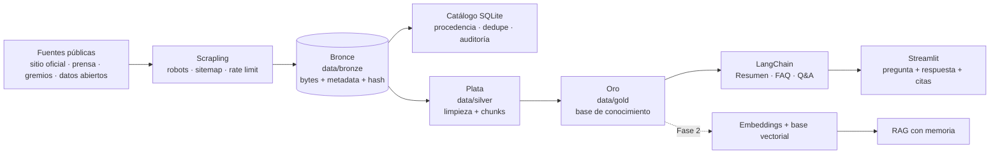

# RAG Ingenio Manuelita — Sistema Q&A

[](https://www.python.org/)
[](https://docs.astral.sh/uv/)
[](LICENSE)
[](tests/)
[](https://github.com/jasonCastano/proyecto_modelos_lenguaje/actions/workflows/ci.yml)
[](CONSTITUTION.md)

Sistema de preguntas y respuestas (Q&A) construido sobre información pública de **Ingenio Manuelita S.A.**,
empresa agroindustrial del Valle del Cauca, Colombia. El proyecto evoluciona desde una base de conocimiento
con Prompt Engineering (Módulo 1) hacia un sistema RAG con embeddings, recuperación y memoria (Módulo 2), y
finalmente un chatbot evaluado y desplegable.

**Curso**: Técnicas Avanzadas de IA aplicadas en Modelos de Lenguaje — Maestría en IA y Ciencia de Datos,
Universidad Autónoma de Occidente, 2026-2S.

**Equipo**: Jason Alejandro Castaño · Roberto José Guerrero.

**Docente**: Jan Polanco Velasco.

**Repositorio**: https://github.com/jasonCastano/proyecto_modelos_lenguaje

> **Estado actual**: las capas bronce, plata y oro están implementadas y validadas. La app Streamlit, las tareas
> LangChain, la evaluación de 40 preguntas (20 núcleo + 20 extendidas) y el informe del Módulo 1 están en desarrollo.

---

## Tabla de contenido

- [Problema](#problema)
- [Solución](#solución)
- [Arquitectura](#arquitectura)
- [Capturas](#capturas)
- [Estado del proyecto](#estado-del-proyecto)
- [Fuentes de datos](#fuentes-de-datos)
- [Stack técnico](#stack-técnico)
- [Requisitos e instalación](#requisitos-e-instalación)
- [Uso](#uso)
- [Capas de datos](#capas-de-datos)
- [Estructura del repositorio](#estructura-del-repositorio)
- [Calidad y reproducibilidad](#calidad-y-reproducibilidad)
- [Ética, privacidad y legalidad](#ética-privacidad-y-legalidad)
- [Limitaciones conocidas](#limitaciones-conocidas)
- [Documentación](#documentación)
- [Roadmap](#roadmap)
- [Créditos](#créditos)
- [Licencia](#licencia)
- [Cómo citar](#cómo-citar)

---

## Problema

Un cliente que se acerca por primera vez a Ingenio Manuelita necesita respuestas rápidas y confiables sobre
identidad, historia, sedes, productos, certificaciones, sostenibilidad, noticias, vacantes y datos corporativos.
Esa información está dispersa en el sitio oficial, medios, redes sociales y portales públicos, y un asistente
genérico puede responder con datos desactualizados o inventados.

**Necesidad**: un canal de comunicación automatizado, preciso y trazable que responda únicamente con información
pública verificable de la empresa y cite la fuente de cada afirmación.

## Solución

Construir una base de conocimiento semántico y un sistema Q&A/RAG con estas características:

- **Recolección reproducible** de fuentes públicas con `scrapling`, respetando `robots.txt`, `sitemap.xml`,
  `User-Agent`, timeout y límites de tasa.
- **Arquitectura medallion**: bronce (crudo), plata (limpio/chunks) y oro (base de conocimiento).
- **Procedencia completa**: URL, título, fecha UTC, hash SHA-256, fuente, tipo, idioma y categoría.
- **Q&A anclado al contexto**: el modelo responde solo con el contexto recuperado, cita fuentes y declara cuando
  no tiene evidencia.
- **Evaluación empírica**: 40 preguntas (20 núcleo + 20 extendidas), comparación de prompts y análisis de errores.
- **Interfaz de prueba** en Streamlit con Resumen, FAQ y Q&A.

## Arquitectura



**Decisiones clave**:

- El bronce es **inmutable**: los bytes originales se conservan con hash; la limpieza ocurre en plata/oro.
- El catálogo SQLite es la fuente de verdad para procedencia, deduplicación, versiones, cobertura y auditoría.
- El contenido retirado se mueve a `data/quarantine/` con auditoría y ventana de reversibilidad.
- El dominio oficial `manuelita.com` nunca se elimina del corpus activo.

## Capturas

Las capturas de la interfaz Streamlit se agregarán cuando se implemente la app del Módulo 1. Por ahora la
verificación se realiza con la CLI, los reportes de campaña y el catálogo; no se incluyen imágenes simuladas.

## Estado del proyecto

| Componente | Estado | Evidencia |
|------------|--------|-----------|
| Repositorio público | ✅ | GitHub `jasonCastano/proyecto_modelos_lenguaje` |
| Licencia MIT | ✅ | `LICENSE` 2026 |
| Pipeline bronce | ✅ | 26.905 artefactos, 26.905 hashes únicos |
| Corpus activo | ✅ | 557 artefactos: 397 oficiales + 111 YouTube + 41 Fundación + 8 de terceros |
| Cobertura del sitio oficial | ✅ | 249/250 páginas del sitemap (99,6%) |
| Canales oficiales | ✅ | YouTube y Fundación capturados; Instagram y Linktree bloqueados por `robots.txt` (`docs/fuentes_oficiales.md`) |
| Capa plata | ✅ | 404 documentos canónicos, 3.810 fragmentos, 92 alias; `data/silver/` |
| Capa oro | ✅ | 15.211 unidades, 381 hechos, 38 conflictos, 24/24 ítems; `data/gold/` |
| Deduplicación y versionado | ✅ | `content_hash`, `url_versions` + MinHash/LSH en plata y Jaccard en oro |
| Reanudación e idempotencia | ✅ | Pruebas de integración de bronce, plata y oro |
| Cuarentena y auditoría | ✅ | 26.347 artefactos retirados, 26.347 auditorías |
| Pruebas | ✅ | 185 pruebas offline |
| Calidad de código | ✅ | Ruff limpio |
| Modelo y entorno | ✅ | Ollama local, `config/llm.toml`, adaptador offline |
| App Streamlit + LangChain | 🟡 | Dependencias LangChain instaladas; tareas pendientes (Módulo 1) |
| Evaluación de 40 preguntas | 🟡 | Pendiente |
| Informe del Módulo 1 | 🟡 | Pendiente |
| CI y Pull Requests | 🟡 | 14 PRs fusionados; workflow de CI verde |
| Cobertura de los 24 ítems | ✅ | 24/24 evaluados por la capa oro con evidencia |

### Cifras actuales

| Métrica | Valor |
|---------|------:|
| Artefactos adquiridos | 26.905 |
| Artefactos activos | 557 |
| Artefactos en cuarentena | 26.347 |
| Videos de YouTube con transcripción | 33 |
| Documentos plata canónicos | 404 |
| Fragmentos plata | 3.810 |
| Unidades oro | 15.211 |
| Hechos oro | 381 |
| Conflictos oro | 38 |
| Cobertura oro | 24/24 ítems |
| Bronze activo | 0,36 GB |
| Plata | 0,03 GB |
| Oro | 0,20 GB |
| Cuarentena | 8,93 GB |
| Datos totales | 9,52 GB (límite: 10 GB) |
| Pruebas offline | 185 |

## Fuentes de datos

| Fuente | Artefactos activos | Uso |
|--------|-------------------:|-----|
| Sitio oficial `manuelita.com` | 397 | Identidad, historia, productos, sostenibilidad, noticias, informes, vacantes |
| YouTube `@ManuelitaAgroindustria` | 111 | Metadatos del canal, 33 videos con transcripción (28 por subtítulos, 5 por ASR) y versiones de metadatos con `subtitle_kinds` |
| Fundación Manuelita | 41 | Fundación enlazada desde el Linktree oficial; informe de gestión 2025 |
| El País | 4 | Rankings y menciones empresariales |
| Cámara de Comercio de Cali | 1 | Contexto empresarial y clústeres |
| Asocañá | 1 | Contexto del sector agroindustrial |
| datos.gov.co | 2 | Patrimonio y registros territoriales con mención a Manuelita |
| Instagram | 0 | Bloqueado por `robots.txt` y por los términos de Meta |
| Linktree | 0 | Bloqueado por `robots.txt`; solo agrega enlaces ya cubiertos |
| SECOP / Supersociedades | 0 | Fuera del corpus activo por curaduría de relevancia |
| Computrabajo | 0 | Restringido por términos de servicio |

> El detalle de accesibilidad, política y vacíos de los canales oficiales está en
> [`docs/fuentes_oficiales.md`](docs/fuentes_oficiales.md). La cobertura de los 24 ítems sigue en
> revisión: la matriz por palabras clave no distingue evidencia real de falsos positivos.


## Stack técnico

| Componente | Tecnología |
|------------|------------|
| Lenguaje | Python 3.14+ |
| Entorno y dependencias | `uv`, `pyproject.toml`, `uv.lock` |
| Scraping | `scrapling[fetchers]` + `yt-dlp` |
| Extracción plata | `trafilatura` + `lxml` (HTML), `pypdf` (PDF), `openpyxl` (XLSX) |
| Transcripción local | `faster-whisper` (extra `asr`, opcional) |
| Catálogo | SQLite (WAL) + manifiestos JSONL |
| Pruebas | `pytest` |
| Lint y formato | `ruff` |
| LLM (Módulo 1) | LangChain (planificado) |
| Interfaz (Módulo 1) | Streamlit (planificado) |
| RAG (Módulo 2) | Embeddings + base vectorial (planificado) |

## Requisitos e instalación

- Python 3.14 o superior.
- [`uv`](https://docs.astral.sh/uv/) instalado.
- Conexión a internet solo para campañas reales; las pruebas no la requieren.

```bash
git lfs install
git clone https://github.com/jasonCastano/proyecto_modelos_lenguaje.git
cd proyecto_modelos_lenguaje
git lfs pull
uv sync --frozen
uv run ruff check .
uv run pytest
```

Los datos de bronce, plata y oro se descargan con Git LFS (~489 MB). La cuarentena no se versiona ni se
descarga.

## Uso

### Pipeline bronce

```bash
# Entrada canónica: ayuda y campaña real o reanudación
uv run python scripts/scrape_empresa.py --help
uv run python scripts/scrape_empresa.py \
  --config config/sources.toml \
  --campaign 2026-10-baseline \
  --resume

# Prueba segura sin escribir en el bronce
uv run python scripts/scrape_empresa.py \
  --campaign 2026-10-m1-02-smoke \
  --limit 3 \
  --dry-run \
  --json

# Inicializar catálogo, fuentes y los 24 ítems
uv run pml init --config config/sources.toml --json

# Alternativa de bajo nivel: campaña real o reanudación
uv run python scripts/run_campaign.py \
  --config config/sources.toml \
  --campaign 2026-10-baseline

# Verificar integridad del corpus activo
uv run python scripts/verify_bronze.py \
  --campaign 2026-10-baseline --sample 50 --seed 1 --json

# Cobertura de los 24 ítems sobre el corpus activo
uv run pml coverage --campaign 2026-10-baseline --active-only --json

# Catálogo y exportación
uv run python scripts/query_catalog.py list --campaign 2026-10-baseline --limit 10 --json
uv run python scripts/query_catalog.py export \
  --campaign 2026-10-baseline --active-only \
  --format jsonl --output exports/curated.jsonl
```

### Canales oficiales y transcripciones

```bash
# YouTube + Linktree + Instagram (estas dos últimas se registran como bloqueadas por robots.txt)
uv run pml init --config config/official_channels.toml --json
uv run python scripts/run_campaign.py \
  --config config/official_channels.toml \
  --campaign 2026-10-official-channels-3

# Fundación Manuelita (enlazada desde el Linktree oficial)
uv run pml init --config config/fundacion_manuelita.toml --json
uv run python scripts/run_campaign.py \
  --config config/fundacion_manuelita.toml \
  --campaign 2026-10-fundacion-manuelita

# Reintento de subtítulos limitados por YouTube
uv run python scripts/run_campaign.py \
  --config config/youtube_backfill.toml \
  --campaign 2026-10-youtube-backfill-1

# Transcripción local de videos sin subtítulos (descarga el modelo la primera vez)
uv run --extra asr python scripts/transcribe_youtube.py \
  --url "https://www.youtube.com/watch?v=VwAvljONZd0" \
  --model small

# Auditoría de fuentes, política y transcripciones
uv run python scripts/verify_official_channels.py
```

El detalle de qué se pudo capturar en cada canal, qué quedó bloqueado y por qué está en
[`docs/fuentes_oficiales.md`](docs/fuentes_oficiales.md).

### Modelo local (Ollama)

El Módulo 1 usa un modelo local de bajo costo. La configuración vive en `config/llm.toml`; no se
versionan claves ni `.env`.

```bash
# Instalar Ollama y descargar el modelo (runtime del sistema, fuera de uv)
ollama serve
ollama pull llama3.1:8b
ollama list

# Ver la configuración efectiva y comprobar el modelo
uv run python -m proyecto_modelos_lenguaje.llm --print-config
uv run python -m proyecto_modelos_lenguaje.llm --check
```

- Modelo por defecto: `llama3.1:8b`.
- Respaldo para equipos con poca RAM/VRAM: `llama3.2:3b`.
- Contexto configurado: 16.384 tokens; paquete por defecto: 8.000 tokens.
- `OLLAMA_BASE_URL` se puede cambiar en `.env` (copia `.env.example`).
- `--check` devuelve `0` si Ollama responde y el modelo está descargado; `2` con un mensaje accionable si
  falta el servidor o el modelo.
- Las pruebas usan `build_fake_model()` y no requieren Ollama ni red.

### Capa plata (silver)

```bash
# Construir o actualizar la capa plata
uv run pml silver build --run 2026-10-silver-01 --json

# Humo con diez artefactos
uv run pml silver build --run 2026-10-silver-00 --limit 10 --json

# Auditoría, reporte y estado
uv run pml silver verify --run 2026-10-silver-01 --sample 50 --seed 1 --json
uv run pml silver report --run 2026-10-silver-01 --format md
uv run pml silver status --json

# Envoltorio canónico
uv run python scripts/build_silver.py --run 2026-10-silver-01 --json
```

Salidas en `data/silver/`:

```text
data/silver/
├── documents.jsonl                  # documentos canónicos y alias
├── chunks.jsonl                     # fragmentos de documentos canónicos
├── markdown/<doc_id>.md             # revisión humana con frontmatter
├── _meta/state.jsonl                # estado incremental por artefacto
└── reports/<run_id>/quality.{json,md}
```

La plata es determinista y offline: no usa LLM, embeddings ni OCR. Los PDF escaneados, cifrados o sin texto
se omiten con una razón; no se inventa contenido. La configuración está en `config/silver.toml` y su hash queda
registrado en cada ejecución.

### Capa oro (gold)

```bash
# Construir o actualizar la base consolidada
uv run pml gold build --run 2026-10-gold-01 --json

# Humo con diez documentos
uv run pml gold build --run 2026-10-gold-00 --limit 10 --json

# Auditoría, reporte y estado
uv run pml gold verify --run 2026-10-gold-01 --sample 100 --json
uv run pml gold report --run 2026-10-gold-01 --format md
uv run pml gold status --json

# Envoltorio canónico
uv run python scripts/build_gold.py --run 2026-10-gold-01 --json
```

Salidas en `data/gold/`:

```text
data/gold/
├── knowledge_units.jsonl          # unidades extractivas con evidencia
├── facts.jsonl                    # hechos numéricos/fechados
├── entities.jsonl                 # entidades canónicas y alias
├── conflicts.jsonl                # contradicciones y resolución
├── coverage.json / coverage.md    # matriz de los 24 ítems
├── faq_seeds.jsonl                # preguntas semilla para FAQ
├── context_8000.* / context_32000.*  # contexto con citas
├── topics/<topic_id>.md           # páginas de tema
├── glossary.md
├── manifest.json
└── reports/<run_id>/quality.{json,md}
```

La capa oro es extractiva y determinista: no resume, no responde, no traduce y no usa embeddings. Cada unidad
conserva su cita; los conflictos se preservan y los vacíos de cobertura se declaran.

### Tareas del Módulo 1: Resumen, FAQ y Q&A (M1-05)

Las tres tareas usan LangChain sobre la capa de oro, con recuperación léxica determinista (sin embeddings),
prompts versionados en `prompts/` y citas `[U#]` verificables. La configuración vive en `config/tasks.toml`.

```bash
# Q&A con citas y fallback explícito
uv run python -m proyecto_modelos_lenguaje.tasks qa \
  --question "¿Qué productos ofrece Manuelita?" --json

# Resumen del paquete de contexto (8.000 tokens por defecto)
uv run python -m proyecto_modelos_lenguaje.tasks summary --pack 8000 --json

# FAQ con evidencia (10 a 20 preguntas)
uv run python -m proyecto_modelos_lenguaje.tasks faq --limit 12 --json
```

- `--fake` usa un modelo falso determinista: no requiere Ollama ni red, ideal para CI y para revisar el flujo.
- `--config` apunta a otra configuración; `--json` emite un único objeto JSON (o una lista, en `faq`).
- Códigos de salida: `0` resultado (incluido `fallback`), `1` error controlado del modelo, `2` error de uso.
- La variable `PML_GOLD_DIR` permite apuntar a otra capa de oro (por defecto `data/gold`).
- Si el corpus no sostiene la respuesta, el resultado es `status=fallback`, `citations=[]` y el mensaje
  «No hay evidencia suficiente en el corpus para responder.»; nunca se inventa contenido.
- Guía de validación completa: [`specs/007-langchain-qa-tasks/quickstart.md`](specs/007-langchain-qa-tasks/quickstart.md).
- Decisión de arquitectura: [`docs/decisions/0007-langchain-tasks.md`](docs/decisions/0007-langchain-tasks.md).

### Curaduría de relevancia

```bash
uv run pml curate analyze --relevance-config config/relevance.toml --json
uv run pml curate analyze --relevance-config config/relevance.toml \
  --run 2026-10-curation-01 --apply --json
uv run pml curate review list --run 2026-10-curation-01 --json
uv run pml curate approve --run 2026-10-curation-01 --reviewer "tu nombre"
uv run pml curate quarantine --run 2026-10-curation-01 --confirm
uv run pml curate purge --run 2026-10-curation-01 --expired --confirm
```

### Bitácora del proyecto

```bash
uv run python .opencode/skills/bitacora/scripts/generate_bitacora.py
```

Genera un archivo fechado en `bitacora/` con el estado de Git local/remoto, el avance, los pendientes y los
próximos pasos.

### Aplicación Q&A (pendiente)

Cuando se implemente la interfaz del Módulo 1:

```bash
uv run streamlit run app.py
```

## Capas de datos

| Capa | Ruta | Equivalente en la rúbrica | Estado |
|------|------|---------------------------|--------|
| Bronce | `data/bronze/` | `data/raw/` | ✅ Implementada |
| Plata | `data/silver/` | `data/processed/` | ✅ Implementada |
| Oro | `data/gold/` | `data/gold/` | ✅ Implementada |
| Cuarentena | `data/quarantine/` | — | ✅ Auditoría de retiros |

```text
data/bronze/
├── raw/<fuente>/<campaña>/<sha256>.<ext>   # bytes originales
├── manifests/<campaña>.jsonl               # metadata de cada artefacto
├── reports/<campaña>/                      # reportes de campaña y cobertura
└── _meta/bronze.sqlite3                    # catálogo SQLite

data/silver/
├── documents.jsonl                         # documentos canónicos y alias
├── chunks.jsonl                            # fragmentos recuperables
├── markdown/<doc_id>.md                    # revisión con frontmatter YAML
├── _meta/state.jsonl                       # estado incremental
└── reports/<run_id>/quality.{json,md}      # calidad por ejecución
```

El límite de 10 GB se controla sobre `data/bronze/`. Bronce, plata y oro se versionan en **Git LFS**;
la cuarentena, los cachés, los smoke runs y `data/module1/` quedan fuera de Git. Los datos también se
referencian por manifiesto y hash.

## Estructura del repositorio

```text
.
├── app.py                         # Interfaz Streamlit (pendiente, Módulo 1)
├── bitacora/                      # Bitácoras fechadas del proyecto
├── config/                        # Fuentes, cobertura, exclusiones y reglas
├── data/                          # Capas medallion (no versionado)
│   ├── bronze/                    # Crudo, inmutable
│   ├── silver/                    # Texto limpio, secciones y chunks
│   ├── gold/                      # Base de conocimiento (pendiente)
│   └── quarantine/                # Retiros con auditoría
├── scripts/                       # Entradas operativas reproducibles
├── specs/                         # Especificaciones, planes y contratos
│   ├── 001-bronze-web-scraping/
│   └── 002-manuelita-relevance-filter/
├── src/proyecto_modelos_lenguaje/ # Paquete: datos, catálogo, curación, CLI
├── tests/                         # Unitarias, integración y contrato
├── .opencode/skills/bitacora/     # Skill de bitácora
├── CONSTITUTION.md                # Reglas del proyecto y rúbrica
├── LICENSE                        # MIT 2026
├── README.md
├── pyproject.toml
└── uv.lock
```

## Calidad y reproducibilidad

- **Entorno reproducible**: `uv sync --frozen`; versiones fijadas en `uv.lock`.
- **Pruebas offline**: 185 pruebas unitarias, de integración y de contrato.
- **Lint**: `uv run ruff check .` sin hallazgos.
- **Integridad**: SHA-256 por artefacto; verificación de muestras del corpus activo.
- **Procedencia**: URL canónica, fecha UTC, tipo, tamaño, categoría, idioma y campaña.
- **Deduplicación**: una copia por `content_hash`; URL alternas como alias.
- **Reanudación**: checkpoints y estados por objetivo; reintentos con backoff.
- **Auditoría**: retiros con URL, hash, motivo, puntuación y fecha.
- **Configuración versionada**: `config_hash` por campaña y por ejecución de curaduría.

```bash
uv run pytest
uv run ruff check .
uv run python scripts/verify_bronze.py --campaign 2026-10-baseline --sample 50 --seed 1 --json
```

## Ética, privacidad y legalidad

- Solo se recolecta información pública, sin autenticación, muros de pago ni elusión de controles.
- Se respetan `robots.txt`, `sitemap.xml`, términos de servicio, `User-Agent`, timeout y rate limit.
- No se incorporan datos personales sensibles; los nombres y cargos corporativos públicos se citan con fines
  académicos.
- El contenido de terceros pertenece a sus fuentes y se atribuye; se atienden solicitudes de retiro.
- Las respuestas del sistema no constituyen asesoría oficial de Ingenio Manuelita.
- No se versionan claves, `.env`, cuarentena ni credenciales; bronce, plata y oro van en Git LFS.

## Limitaciones conocidas

- El corpus activo es de 557 artefactos; 26.347 fueron retirados a cuarentena por no ser relevantes.
- La cuarentena ocupa 8,93 GB y el total de datos está en 9,29 GB; la purga definitiva está pendiente.
- La capa plata produjo 404 documentos canónicos y 3.810 fragmentos; 92 artefactos quedaron como alias por
  duplicados o versiones. 61 se omitieron: 35 sin texto, 10 PDF escaneados, 6 PDF cifrados y 10 sitemaps.
- Instagram y Linktree no se capturan por `robots.txt`; 30 videos de YouTube no están disponibles y 3 exigen sesión.
- La matriz de 24 ítems requiere recalibración: SECOP, NIT, precios, fichas técnicas y catálogos aún no tienen
  evidencia verificable.
- La capa oro produjo 15.211 unidades extractivas, 381 hechos, 15 entidades y 38 conflictos; 24/24 ítems
  evaluados. Los conflictos y la cobertura requieren revisión muestral antes de la evaluación final.
- La app Streamlit, LangChain, las 40 preguntas y el informe del Módulo 1 están pendientes.
- El repositorio tiene 7 PRs fusionados y CI verde en GitHub Actions.

## Documentación

- [Constitución del proyecto](CONSTITUTION.md)
- [Ficha de datos del corpus](docs/data_card.md)
- [Alcance del Q&A y banco de 40 preguntas](docs/alcance.md)
- [Especificación del bronce](specs/001-bronze-web-scraping/spec.md)
- [Plan del bronce](specs/001-bronze-web-scraping/plan.md)
- [Especificación de curaduría](specs/002-manuelita-relevance-filter/spec.md)
- [Plan de curaduría](specs/002-manuelita-relevance-filter/plan.md)
- [Especificación de la capa plata](specs/003-silver-medallion-layer/spec.md)
- [Plan de la capa plata](specs/003-silver-medallion-layer/plan.md)
- [Guía de validación de la capa plata](specs/003-silver-medallion-layer/quickstart.md)
- [Decisión de arquitectura de la capa plata](docs/decisions/0003-silver-layer.md)
- [Especificación de la capa oro](specs/004-gold-medallion-layer/spec.md)
- [Plan de la capa oro](specs/004-gold-medallion-layer/plan.md)
- [Guía de validación de la capa oro](specs/004-gold-medallion-layer/quickstart.md)
- [Decisión de arquitectura de la capa oro](docs/decisions/0004-gold-layer.md)
- [Especificación de la entrada canónica de scraping](specs/005-scrape-empresa-entrypoint/spec.md)
- [Plan de la entrada canónica de scraping](specs/005-scrape-empresa-entrypoint/plan.md)
- [Guía de validación de la entrada canónica](specs/005-scrape-empresa-entrypoint/quickstart.md)
- [Decisión de arquitectura de la entrada canónica](docs/decisions/0005-scrape-entrypoint.md)
- [Especificación técnica del modelo Ollama](specs/006-llm-ollama-config/spec.md)
- [Especificación de tareas LangChain](specs/007-langchain-qa-tasks/spec.md)
- [Plan de tareas LangChain](specs/007-langchain-qa-tasks/plan.md)
- [Tareas de LangChain](specs/007-langchain-qa-tasks/tasks.md)
- [Guía de validación de tareas LangChain](specs/007-langchain-qa-tasks/quickstart.md)
- [Decisión de arquitectura del modelo Ollama](docs/decisions/0006-ollama-llm.md)
- [Verificación de canales oficiales](docs/fuentes_oficiales.md)
- [Bitácora del 2026-10-29](bitacora/2026-10-29.md)
- [Guía de validación del bronce](specs/001-bronze-web-scraping/quickstart.md)

## Roadmap

### Fase 1 — Módulo 1: base de conocimiento y Q&A

- [x] Pipeline bronce y catálogo de procedencia.
- [x] Curación de relevancia y cuarentena auditada.
- [ ] Capas silver/gold y chunks.
- [ ] Tareas LangChain: Resumen, FAQ y Q&A.
- [ ] App Streamlit con métricas y citas.
- [ ] 40 preguntas evaluadas (20 núcleo + 20 extendidas) y comparación de prompts.
- [ ] Informe y demo 12+3 minutos.
- [ ] CI, Pull Requests y tag `v0.1.0-modulo1`.

### Fase 2 — Módulo 2: embeddings, memoria y RAG

- [ ] Modelo de embeddings multilingüe.
- [ ] Base vectorial y recuperación.
- [ ] Métricas Recall@k, MRR y fidelidad.
- [ ] RAG con citas y memoria conversacional.

### Fase 3 — Chatbot final

- [ ] Guardrails y evaluación.
- [ ] Despliegue reproducible.
- [ ] Observabilidad y documentación final.

## Créditos

**Autores**

- Jason Alejandro Castaño — datos, pipeline y reproducibilidad.
- Roberto José Guerrero — LLM, prompts y aplicación.

**Curso**

- Técnicas Avanzadas de IA aplicadas en Modelos de Lenguaje.
- Maestría en IA y Ciencia de Datos, Universidad Autónoma de Occidente, 2026-2S.
- Docente: Jan Polanco Velasco.

**Fuentes**

- Ingenio Manuelita S.A. y su sitio oficial.
- Medios, gremios y portales públicos citados en el catálogo.

## Licencia

Este proyecto se distribuye bajo la **Licencia MIT**. Consulta [LICENSE](LICENSE).

Copyright © 2026 Jason Alejandro Castaño y Roberto José Guerrero.

El contenido recolectado pertenece a sus respectivas fuentes y se usa con fines académicos.

## Cómo citar

```bibtex
@misc{castano_guerrero_2026_manuelita_rag,
  title  = {RAG Ingenio Manuelita: sistema de preguntas y respuestas},
  author = {Castaño, Jason Alejandro and Guerrero, Roberto José},
  year   = {2026},
  url    = {https://github.com/jasonCastano/proyecto_modelos_lenguaje}
}
```
