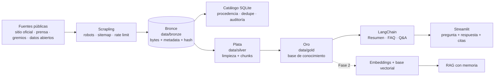

# RAG Ingenio Manuelita — Sistema Q&A

[](https://www.python.org/)
[](https://docs.astral.sh/uv/)
[](LICENSE)
[](tests/)
[](CONSTITUTION.md)

Sistema de preguntas y respuestas (Q&A) construido sobre información pública de **Ingenio Manuelita S.A.**,
empresa agroindustrial del Valle del Cauca, Colombia. El proyecto evoluciona desde una base de conocimiento
con Prompt Engineering (Módulo 1) hacia un sistema RAG con embeddings, recuperación y memoria (Módulo 2), y
finalmente un chatbot evaluado y desplegable.

**Curso**: Técnicas Avanzadas de IA aplicadas en Modelos de Lenguaje — Maestría en IA y Ciencia de Datos,
Universidad Autónoma de Occidente, 2026-2S.

**Equipo**: Jason Alejandro Castaño · Roberto José Guerrero.

**Docente**: Jan Polanco Velasco.

**Repositorio**: https://github.com/jasonCastano/proyecto_modelos_lenguaje

> **Estado actual**: la capa bronce está implementada y validada. La app Streamlit, las tareas LangChain, las
> capas silver/gold, la evaluación de 20 preguntas y el informe del Módulo 1 están en desarrollo. La matriz de
> cobertura de los 24 ítems está en revisión y **no se declara completa**.

---

## Tabla de contenido

- [Problema](#problema)
- [Solución](#solución)
- [Arquitectura](#arquitectura)
- [Capturas](#capturas)
- [Estado del proyecto](#estado-del-proyecto)
- [Fuentes de datos](#fuentes-de-datos)
- [Stack técnico](#stack-técnico)
- [Requisitos e instalación](#requisitos-e-instalación)
- [Uso](#uso)
- [Capas de datos](#capas-de-datos)
- [Estructura del repositorio](#estructura-del-repositorio)
- [Calidad y reproducibilidad](#calidad-y-reproducibilidad)
- [Ética, privacidad y legalidad](#ética-privacidad-y-legalidad)
- [Limitaciones conocidas](#limitaciones-conocidas)
- [Documentación](#documentación)
- [Roadmap](#roadmap)
- [Créditos](#créditos)
- [Licencia](#licencia)
- [Cómo citar](#cómo-citar)

---

## Problema

Un cliente que se acerca por primera vez a Ingenio Manuelita necesita respuestas rápidas y confiables sobre
identidad, historia, sedes, productos, certificaciones, sostenibilidad, noticias, vacantes y datos corporativos.
Esa información está dispersa en el sitio oficial, medios, redes sociales y portales públicos, y un asistente
genérico puede responder con datos desactualizados o inventados.

**Necesidad**: un canal de comunicación automatizado, preciso y trazable que responda únicamente con información
pública verificable de la empresa y cite la fuente de cada afirmación.

## Solución

Construir una base de conocimiento semántico y un sistema Q&A/RAG con estas características:

- **Recolección reproducible** de fuentes públicas con `scrapling`, respetando `robots.txt`, `sitemap.xml`,
  `User-Agent`, timeout y límites de tasa.
- **Arquitectura medallion**: bronce (crudo), plata (limpio/chunks) y oro (base de conocimiento).
- **Procedencia completa**: URL, título, fecha UTC, hash SHA-256, fuente, tipo, idioma y categoría.
- **Q&A anclado al contexto**: el modelo responde solo con el contexto recuperado, cita fuentes y declara cuando
  no tiene evidencia.
- **Evaluación empírica**: 20 preguntas mínimo, comparación de prompts y análisis de errores.
- **Interfaz de prueba** en Streamlit con Resumen, FAQ y Q&A.

## Arquitectura



**Decisiones clave**:

- El bronce es **inmutable**: los bytes originales se conservan con hash; la limpieza ocurre en plata/oro.
- El catálogo SQLite es la fuente de verdad para procedencia, deduplicación, versiones, cobertura y auditoría.
- El contenido retirado se mueve a `data/quarantine/` con auditoría y ventana de reversibilidad.
- El dominio oficial `manuelita.com` nunca se elimina del corpus activo.

## Capturas

Las capturas de la interfaz Streamlit se agregarán cuando se implemente la app del Módulo 1. Por ahora la
verificación se realiza con la CLI, los reportes de campaña y el catálogo; no se incluyen imágenes simuladas.

## Estado del proyecto

| Componente | Estado | Evidencia |
|------------|--------|-----------|
| Repositorio público | ✅ | GitHub `jasonCastano/proyecto_modelos_lenguaje` |
| Licencia MIT | ✅ | `LICENSE` 2026 |
| Pipeline bronce | ✅ | 26.752 artefactos, 26.752 hashes únicos |
| Corpus activo | ✅ | 405 artefactos: 397 oficiales + 8 de terceros |
| Cobertura del sitio oficial | ✅ | 249/250 páginas del sitemap (99,6%) |
| Deduplicación y versionado | ✅ | `content_hash`, `url_versions` |
| Reanudación e idempotencia | ✅ | Pruebas de integración |
| Cuarentena y auditoría | ✅ | 26.347 artefactos retirados, 26.347 auditorías |
| Pruebas | ✅ | 60 pruebas offline |
| Calidad de código | ✅ | Ruff limpio |
| Capas silver/gold | 🟡 | Pendientes |
| App Streamlit + LangChain | 🟡 | Pendientes (Módulo 1) |
| Evaluación de 20 preguntas | 🟡 | Pendiente |
| Informe del Módulo 1 | 🟡 | Pendiente |
| CI y Pull Requests | 🟡 | Pendientes |
| Cobertura de los 24 ítems | 🟡 | Matriz generada, evidencia en revisión |

### Cifras actuales

| Métrica | Valor |
|---------|------:|
| Artefactos adquiridos | 26.752 |
| Artefactos activos | 405 |
| Artefactos en cuarentena | 26.347 |
| Bronze activo | 0,36 GB |
| Cuarentena | 9,59 GB |
| Datos totales | 9,95 GB (límite: 10 GB) |
| Pruebas offline | 60 |

## Fuentes de datos

| Fuente | Artefactos activos | Uso |
|--------|-------------------:|-----|
| Sitio oficial `manuelita.com` | 397 | Identidad, historia, productos, sostenibilidad, noticias, informes, vacantes |
| El País | 4 | Rankings y menciones empresariales |
| Cámara de Comercio de Cali | 1 | Contexto empresarial y clústeres |
| Asocañá | 1 | Contexto del sector agroindustrial |
| datos.gov.co | 2 | Patrimonio y registros territoriales con mención a Manuelita |
| YouTube | 0 | Pendiente: metadatos y subtítulos |
| Facebook / Instagram | 0 | Bloqueadas por `robots.txt`; se documenta el vacío |
| SECOP / Supersociedades | 0 | Pendiente: datos abiertos y registros |
| Computrabajo | 0 | Restringido por términos de servicio |

> La cobertura de los 24 ítems está en revisión. Varios ítems (YouTube, redes sociales, SECOP, NIT, precios,
> fichas técnicas y catálogos) requieren datos adicionales o una justificación documentada de su ausencia.

## Stack técnico

| Componente | Tecnología |
|------------|------------|
| Lenguaje | Python 3.14+ |
| Entorno y dependencias | `uv`, `pyproject.toml`, `uv.lock` |
| Scraping | `scrapling[fetchers]` + `yt-dlp` |
| Catálogo | SQLite (WAL) + manifiestos JSONL |
| Pruebas | `pytest` |
| Lint y formato | `ruff` |
| LLM (Módulo 1) | LangChain (planificado) |
| Interfaz (Módulo 1) | Streamlit (planificado) |
| RAG (Módulo 2) | Embeddings + base vectorial (planificado) |

## Requisitos e instalación

- Python 3.14 o superior.
- [`uv`](https://docs.astral.sh/uv/) instalado.
- Conexión a internet solo para campañas reales; las pruebas no la requieren.

```bash
git clone https://github.com/jasonCastano/proyecto_modelos_lenguaje.git
cd proyecto_modelos_lenguaje
uv sync --frozen
uv run ruff check .
uv run pytest
```

## Uso

### Pipeline bronce

```bash
# Inicializar catálogo, fuentes y los 24 ítems
uv run pml init --config config/sources.toml --json

# Campaña real o reanudación
uv run python scripts/run_campaign.py \
  --config config/sources.toml \
  --campaign 2026-10-baseline

# Verificar integridad del corpus activo
uv run python scripts/verify_bronze.py \
  --campaign 2026-10-baseline --sample 50 --seed 1 --json

# Cobertura de los 24 ítems sobre el corpus activo
uv run pml coverage --campaign 2026-10-baseline --active-only --json

# Catálogo y exportación
uv run python scripts/query_catalog.py list --campaign 2026-10-baseline --limit 10 --json
uv run python scripts/query_catalog.py export \
  --campaign 2026-10-baseline --active-only \
  --format jsonl --output exports/curated.jsonl
```

### Curaduría de relevancia

```bash
uv run pml curate analyze --relevance-config config/relevance.toml --json
uv run pml curate analyze --relevance-config config/relevance.toml \
  --run 2026-10-curation-01 --apply --json
uv run pml curate review list --run 2026-10-curation-01 --json
uv run pml curate approve --run 2026-10-curation-01 --reviewer "tu nombre"
uv run pml curate quarantine --run 2026-10-curation-01 --confirm
uv run pml curate purge --run 2026-10-curation-01 --expired --confirm
```

### Bitácora del proyecto

```bash
uv run python .opencode/skills/bitacora/scripts/generate_bitacora.py
```

Genera un archivo fechado en `bitacora/` con el estado de Git local/remoto, el avance, los pendientes y los
próximos pasos.

### Aplicación Q&A (pendiente)

Cuando se implemente la interfaz del Módulo 1:

```bash
uv run streamlit run app.py
```

## Capas de datos

| Capa | Ruta | Equivalente en la rúbrica | Estado |
|------|------|---------------------------|--------|
| Bronce | `data/bronze/` | `data/raw/` | ✅ Implementada |
| Plata | `data/silver/` | `data/processed/` | 🟡 Pendiente |
| Oro | `data/gold/` | `data/gold/` | 🟡 Pendiente |
| Cuarentena | `data/quarantine/` | — | ✅ Auditoría de retiros |

```text
data/bronze/
├── raw/<fuente>/<campaña>/<sha256>.<ext>   # bytes originales
├── manifests/<campaña>.jsonl               # metadata de cada artefacto
├── reports/<campaña>/                      # reportes de campaña y cobertura
└── _meta/bronze.sqlite3                    # catálogo SQLite
```

El límite de 10 GB se controla sobre `data/bronze/`. `data/` no se versiona; los datos se referencian por
manifiesto y hash.

## Estructura del repositorio

```text
.
├── app.py                         # Interfaz Streamlit (pendiente, Módulo 1)
├── bitacora/                      # Bitácoras fechadas del proyecto
├── config/                        # Fuentes, cobertura, exclusiones y reglas
├── data/                          # Capas medallion (no versionado)
│   ├── bronze/                    # Crudo, inmutable
│   ├── silver/                    # Limpieza y chunks (pendiente)
│   ├── gold/                      # Base de conocimiento (pendiente)
│   └── quarantine/                # Retiros con auditoría
├── scripts/                       # Entradas operativas reproducibles
├── specs/                         # Especificaciones, planes y contratos
│   ├── 001-bronze-web-scraping/
│   └── 002-manuelita-relevance-filter/
├── src/proyecto_modelos_lenguaje/ # Paquete: datos, catálogo, curación, CLI
├── tests/                         # Unitarias, integración y contrato
├── .opencode/skills/bitacora/     # Skill de bitácora
├── CONSTITUTION.md                # Reglas del proyecto y rúbrica
├── LICENSE                        # MIT 2026
├── README.md
├── pyproject.toml
└── uv.lock
```

## Calidad y reproducibilidad

- **Entorno reproducible**: `uv sync --frozen`; versiones fijadas en `uv.lock`.
- **Pruebas offline**: 60 pruebas unitarias, de integración y de contrato.
- **Lint**: `uv run ruff check .` sin hallazgos.
- **Integridad**: SHA-256 por artefacto; verificación de muestras del corpus activo.
- **Procedencia**: URL canónica, fecha UTC, tipo, tamaño, categoría, idioma y campaña.
- **Deduplicación**: una copia por `content_hash`; URL alternas como alias.
- **Reanudación**: checkpoints y estados por objetivo; reintentos con backoff.
- **Auditoría**: retiros con URL, hash, motivo, puntuación y fecha.
- **Configuración versionada**: `config_hash` por campaña y por ejecución de curaduría.

```bash
uv run pytest
uv run ruff check .
uv run python scripts/verify_bronze.py --campaign 2026-10-baseline --sample 50 --seed 1 --json
```

## Ética, privacidad y legalidad

- Solo se recolecta información pública, sin autenticación, muros de pago ni elusión de controles.
- Se respetan `robots.txt`, `sitemap.xml`, términos de servicio, `User-Agent`, timeout y rate limit.
- No se incorporan datos personales sensibles; los nombres y cargos corporativos públicos se citan con fines
  académicos.
- El contenido de terceros pertenece a sus fuentes y se atribuye; se atienden solicitudes de retiro.
- Las respuestas del sistema no constituyen asesoría oficial de Ingenio Manuelita.
- No se versionan claves, `.env`, datos ni credenciales.

## Limitaciones conocidas

- El corpus activo es de 405 artefactos; 26.347 fueron retirados a cuarentena por no ser relevantes.
- La cuarentena ocupa 9,59 GB y el total de datos está en 9,95 GB; la purga definitiva está pendiente.
- La matriz de 24 ítems requiere recalibración: YouTube, redes sociales, SECOP, NIT, precios, fichas técnicas y
  catálogos aún no tienen evidencia suficiente.
- La app Streamlit, LangChain, las capas silver/gold, las 20 preguntas y el informe del Módulo 1 están pendientes.
- El repositorio aún no tiene CI ni Pull Requests fusionados.

## Documentación

- [Constitución del proyecto](CONSTITUTION.md)
- [Especificación del bronce](specs/001-bronze-web-scraping/spec.md)
- [Plan del bronce](specs/001-bronze-web-scraping/plan.md)
- [Especificación de curaduría](specs/002-manuelita-relevance-filter/spec.md)
- [Plan de curaduría](specs/002-manuelita-relevance-filter/plan.md)
- [Bitácora del 2026-10-29](bitacora/2026-10-29.md)
- [Guía de validación del bronce](specs/001-bronze-web-scraping/quickstart.md)

## Roadmap

### Fase 1 — Módulo 1: base de conocimiento y Q&A

- [x] Pipeline bronce y catálogo de procedencia.
- [x] Curación de relevancia y cuarentena auditada.
- [ ] Capas silver/gold y chunks.
- [ ] Tareas LangChain: Resumen, FAQ y Q&A.
- [ ] App Streamlit con métricas y citas.
- [ ] 20 preguntas evaluadas y comparación de prompts.
- [ ] Informe y demo 12+3 minutos.
- [ ] CI, Pull Requests y tag `v0.1.0-modulo1`.

### Fase 2 — Módulo 2: embeddings, memoria y RAG

- [ ] Modelo de embeddings multilingüe.
- [ ] Base vectorial y recuperación.
- [ ] Métricas Recall@k, MRR y fidelidad.
- [ ] RAG con citas y memoria conversacional.

### Fase 3 — Chatbot final

- [ ] Guardrails y evaluación.
- [ ] Despliegue reproducible.
- [ ] Observabilidad y documentación final.

## Créditos

**Autores**

- Jason Alejandro Castaño — datos, pipeline y reproducibilidad.
- Roberto José Guerrero — LLM, prompts y aplicación.

**Curso**

- Técnicas Avanzadas de IA aplicadas en Modelos de Lenguaje.
- Maestría en IA y Ciencia de Datos, Universidad Autónoma de Occidente, 2026-2S.
- Docente: Jan Polanco Velasco.

**Fuentes**

- Ingenio Manuelita S.A. y su sitio oficial.
- Medios, gremios y portales públicos citados en el catálogo.

## Licencia

Este proyecto se distribuye bajo la **Licencia MIT**. Consulta [LICENSE](LICENSE).

Copyright © 2026 Jason Alejandro Castaño y Roberto José Guerrero.

El contenido recolectado pertenece a sus respectivas fuentes y se usa con fines académicos.

## Cómo citar

```bibtex
@misc{castano_guerrero_2026_manuelita_rag,
  title  = {RAG Ingenio Manuelita: sistema de preguntas y respuestas},
  author = {Castaño, Jason Alejandro and Guerrero, Roberto José},
  year   = {2026},
  url    = {https://github.com/jasonCastano/proyecto_modelos_lenguaje}
}
```
