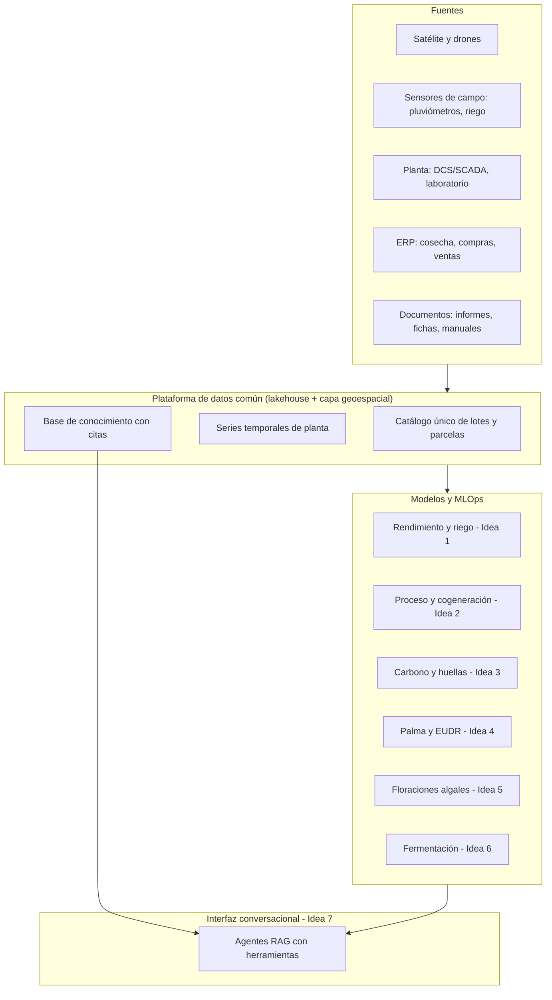

# Ideas de negocio con IA y ciencia de datos para Manuelita

> **Carácter del documento.** Es un ejercicio exploratorio («alucinaciones» en el sentido de ideas
> por validar), no una recomendación oficial ni un análisis financiero. Los **datos de Manuelita**
> provienen de su documentación pública indexada en la capa oro del proyecto (principalmente el
> *Informe de Sostenibilidad 2023-2024*, citado como «IS 2023-2024, p. N»). Las **referencias
> tecnológicas** provienen de una búsqueda web hecha el 2026-11-21. Los beneficios esperados son
> hipótesis que habría que medir con un piloto.
>
> Autor: Roberto José Guerrero · Fecha: 2026-11-21

---

## 1. Punto de partida: qué dice la documentación de Manuelita

Manuelita es una organización agroindustrial diversificada en alimentos y energía renovable, con
presencia en varios países de las Américas (IS 2023-2024, p. 12). Sus plataformas y los datos que
más pesan para pensar en IA son:

| Plataforma | Unidad de negocio | Datos relevantes de la documentación |
|---|---|---|
| Caña de azúcar (Colombia y Perú) | Manuelita Azúcar y Energía; Agroindustrial Laredo | Azúcar (incluida orgánica y vegana), bioetanol carburante e industrial, bioenergía eléctrica, compost y biofertilizantes (p. 8, 48). Plan maestro de riegos desde 2015 (tubería enterrada, goteo, aspersión), con ahorros de agua de hasta 50–60 % frente a riego convencional (p. 10, 110). Monitoreo hidrológico con 6 estaciones limnimétricas y 18 pluviómetros digitales (p. 116). |
| Palma de aceite (Meta y Casanare) | Manuelita Aceites y Energía; Palmar de Altamira | Biodiésel, aceite crudo y refinado, palmiste, glicerina, biogás y bioenergía; clientes en alimentos, cosméticos y energía (p. 8, 42). **72 % de las hectáreas son de proveedores** (p. 39). 1.256 ha de Áreas de Alto Valor de Conservación (p. 132). |
| Frutas y hortalizas (Perú) | Manuelita Frutas y Hortalizas | Uva de mesa, arándanos, espárragos, cítricos y palta, con riego por goteo; exportación a Europa, Asia y América; renovación de variedades de uva y primera campaña de arándano (p. 4, 42, 110). |
| Acuicultura (Chile) | Manuelita Acuicultura | 8.232 → 8.351 t de mejillones procesados (2023 → 2024); 61 % de cultivos de terceros; récord de ventas de valor agregado (p. 4, 42). |

Otros hechos que abren oportunidades:

- **Energía:** cerca de 200.000 MWh/año cogenerados y 45.000–48.000 MWh/año de excedentes
  vendidos (≈ 23 %) (p. 57, 124).
- **Emisiones y agua:**
  - Huella de carbono total 2024 de 459.722 t CO₂eq (p. 128). En 2024 subió el material
    particulado de una planta por ajustes en el control de una caldera (p. 131).
  - Huella hídrica (alcances 1 y 2) de unos 278–301 millones de m³/año, que crece cuando llueve
    menos (p. 117).
- **Carbono y economía circular:**
  - 189.301 créditos de carbono certificados en 2023 (p. 12, 143).
  - Compost aplicado en ≈ 3.900 ha (1.250 + 1.373 + 1.300) (p. 137).
  - Reúso del 98 % de los efluentes industriales para riego (p. 110).
- **Personas y proveedores:**
  - 8.069 colaboradores en 2024 (p. 63).
  - Más de 1.000 pequeños agricultores en «Sembrando Progreso» (p. 104).
  - Control biológico en 627 ha de proveedores (p. 104).
- **Cultura:** el valor «espíritu pionero» busca «la mejor tecnología existente para la
  organización» (p. 23).

**Lectura:** Manuelita ya genera muchos datos (sensores hidrológicos, riego tecnificado, balances
energéticos, huellas de carbono y agua, programas con proveedores), pero la documentación pública no
menciona modelos predictivos, gemelos digitales ni IA. Ese hueco entre «tenemos datos» y «decidimos
con modelos» es la oportunidad.

---

## 2. Ideas de negocio

Cada idea sigue el mismo formato: problema, aplicación de IA, cómo potencia a la empresa, datos
necesarios y primer piloto.

### Idea 1 — «Caña Inteligente»: gemelo digital agronómico (rendimiento + riego)

- **Problema:**
  - El agua es el mayor recurso: unos 300 millones de m³/año, y la huella sube en años secos.
  - La productividad del campo define el costo por tonelada de azúcar y etanol.
- **Aplicación de IA:**
  - Modelos de pronóstico de rendimiento por suerte (lote). Combinan series temporales Sentinel-2
    (índices de vegetación, bandas *red-edge*), clima, suelo y registros de cosecha.
  - Un optimizador de riego que decide cuándo y cuánto regar con el pronóstico de lluvia y los
    18 pluviómetros y 6 estaciones que Manuelita ya tiene.
  - Estado del arte: Random Forest y KNN sobre Sentinel-2 en ingenios de São Paulo (2025). Además,
    Incauca ya trabaja con Nax Solutions un modelo de humedad en caña en el Valle del Cauca.
- **Cómo potencia a Manuelita:**
  - Programa mejor la cosecha y la molienda: corta cada lote en su punto de máxima sacarosa.
  - Reduce el agua y la energía de bombeo, y con ello la huella hídrica que reporta.
  - Abre un negocio nuevo: vender el servicio de pronóstico y recomendación de riego a los
    proveedores de caña, igual que hoy les ofrece control biológico.
- **Datos:** catastro de lotes, históricos de cosecha (t/ha, sacarosa), riego, sensores, imágenes
  satelitales gratuitas (Copernicus).
- **Piloto (3–4 meses):** 1 hacienda y 2 zafras de histórico. La métrica es el error de pronóstico
  frente al estimado actual del agrónomo y los m³ por tonelada de caña.

### Idea 2 — Fábrica y cogeneración autónomas: optimización de procesos y mantenimiento predictivo

- **Problema:**
  - El excedente eléctrico vendido (≈ 45.000–48.000 MWh/año) depende de la eficiencia de calderas,
    molinos y evaporación.
  - En 2024 una caldera desajustada subió las emisiones de material particulado.
- **Aplicación de IA:**
  - Control avanzado de procesos (APC) con modelos de aprendizaje automático sobre los datos del
    DCS/SCADA para la combustión de bagazo, la extracción y la evaporación.
  - Detección de anomalías y mantenimiento predictivo en equipos rotativos.
  - Más adelante, un gemelo digital de la planta para simular escenarios.
  - Referentes:
    - ABB reporta, en un ingenio-destilería de India, hasta 4 % menos combustible y 1 % más
      eficiencia de vapor en la caldera de bagazo (dato de proveedor).
    - British Sugar (con IBM) usó un gemelo digital para reducir fallas de equipos.
- **Cómo potencia a Manuelita:**
  - Más bagazo disponible y más MWh excedentes para vender.
  - Menos paradas no programadas en zafra.
  - Cumplimiento ambiental: alertas tempranas antes de que una caldera se salga de rango.
  - Refuerza el valor de «bioenergía eléctrica» como línea de negocio.
- **Datos:** historiadores de planta (temperaturas, presiones, O₂, flujos), registros de mantenimiento,
  análisis de laboratorio.
- **Piloto:** una caldera con un «asesor de setpoints» en modo recomendación (el operador decide). La
  métrica es t de vapor por t de bagazo y la opacidad o el material particulado.

### Idea 3 — Carbono como producto: dMRV con IA y huella de carbono por lote

- **Problema:**
  - Manuelita ya monetiza créditos de carbono (189.301 certificados) y aplica compost en
    ≈ 3.900 ha.
  - Medir y verificar estos proyectos de forma tradicional es lento y costoso.
  - Sus clientes de alimentos y cosméticos piden cada vez más huellas por producto.
- **Aplicación de IA:**
  - Medición, reporte y verificación digital (dMRV): estima carbono en suelo y biomasa con
    satélite, aprendizaje automático y un muestreo de suelo reducido.
  - Seguimiento automático de las 1.256 ha de conservación y de la reforestación.
  - Un modelo de **huella de carbono y agua por lote de producto** conectado a los datos de campo
    y fábrica.
  - Referentes: plataformas como CarbonSpace, Spacenus o Boomitra. Sus reducciones de costo de
    monitoreo (cifras de los proveedores) llegan al 90 %. La literatura de 2025–2026 muestra que
    el mapeo digital de suelos reduce las deducciones por incertidumbre en proyectos grandes.
- **Cómo potencia a Manuelita:**
  - Más créditos certificables por hectárea y verificaciones más baratas y frecuentes.
  - Nuevos créditos por suelo (compost, cosecha en verde) y biodiversidad.
  - Un sobreprecio para productos «bajos en carbono» (azúcar orgánica, empaque de papel,
    glicerina, biodiésel) con huella auditable por lote.
- **Datos:** inventario de emisiones (alcances 1–3, ya calculado), mapas de lotes, aplicaciones de
  compost, muestras de suelo.
- **Piloto:** comparar dMRV con la medición tradicional en las hectáreas de compost de una unidad.

### Idea 4 — Palma trazable y de precisión: visión por computador + cumplimiento EUDR

- **Problema:**
  - El 72 % de las hectáreas de palma son de proveedores.
  - El reglamento europeo de deforestación (EUDR) exige, desde el **30 de diciembre de 2026** para
    operadores medianos y grandes, la geolocalización de cada parcela de origen y la prueba de que
    no hubo deforestación después del 31-12-2020.
  - La documentación de Manuelita menciona a Colombia como socio de abastecimiento sostenible para
    Europa.
- **Aplicación de IA:**
  - Conteo y salud de palmas con drones y modelos YOLO (95 % de precisión en estudios de 2025).
  - Clasificación de madurez del racimo de fruta fresca (RFF) para cosechar en el punto óptimo;
    se reporta que ≈ 15 % se corta con madurez incorrecta.
  - Monitoreo satelital de cambio de cobertura por parcela de proveedor.
- **Cómo potencia a Manuelita:**
  - Más aceite por tonelada de fruta.
  - Planificación de cosecha y extracción.
  - Acceso garantizado a mercados exigentes (UE) con un expediente de trazabilidad automático.
  - Un servicio de valor para los proveedores pequeños, que solos no podrían cumplir el EUDR.
- **Datos:** polígonos de fincas de proveedores, imágenes de dron y satélite, registros de entrega de
  fruta.
- **Piloto:** mapa de cumplimiento de 20 proveedores y conteo de palmas en 1 finca propia.

### Idea 5 — Acuicultura predictiva: alerta de floraciones algales y calidad en planta

- **Problema:** las floraciones algales nocivas y sus biotoxinas son el principal riesgo del cultivo
  de mejillón. Obligan a cierres preventivos y afectan el abastecimiento de la planta, que procesa
  ≈ 8.350 t/año con un 61 % de producción de terceros.
- **Aplicación de IA:**
  - Pronóstico de floraciones a 1–2 semanas, con modelos híbridos de física, LSTM y satélite.
    En Chile hay referentes como PREDIFAN (ESA), Watermind y un estudio de la Universidad de
    Hiroshima con 30 años de datos chilenos.
  - Visión por computador en la línea de proceso para clasificar media concha, carne IQF y
    defectos.
- **Cómo potencia a Manuelita:**
  - Planifica cosecha y compras a terceros antes de un cierre.
  - Menos producto perdido y más volumen de valor agregado.
  - Calidad constante para Europa y Asia.
  - La empresa sería pionera, porque la IA aplicada al mejillón en Chile casi no tiene antecedentes
    publicados (la mayoría es para salmón).
- **Datos:** registros de cierres sanitarios, muestreos de fitoplancton, temperatura y clorofila
  satelital, rendimientos por centro de cultivo.
- **Piloto:** modelo retrospectivo de cierres con datos públicos de monitoreo y los propios.

### Idea 6 — Biorrefinería inteligente: sensores virtuales en fermentación y valorización de subproductos

- **Problema:**
  - El bioetanol carburante e industrial y los subproductos (vinaza, cachaza, glicerina) son
    márgenes en los que pequeñas mejoras de rendimiento valen mucho.
  - Medir en línea la concentración de etanol y sustrato es difícil.
- **Aplicación de IA:**
  - *Soft sensors* (redes neuronales sobre pH, redox, capacitancia y temperatura) que estiman en
    tiempo real el etanol y el azúcar residual. En laboratorio alcanzan R² de 0,97 (DTU y Andrews
    University, 2024).
  - Optimización de dosificación y tiempos de fermentación.
  - Un modelo de formulación de compost y biofertilizantes según el análisis de suelo del cliente.
- **Cómo potencia a Manuelita:**
  - Más litros por tonelada de azúcares fermentables y menos contaminaciones.
  - Mejor calidad del alcohol industrial para la industria química y farmacéutica.
  - Biofertilizantes «a la medida» como producto para terceros (la documentación menciona su uso
    en arroz, café, piña, plátano, aguacate y cítricos).
- **Datos:** bitácoras de fermentación, laboratorio, analítica de suelo.
- **Piloto:** sensor virtual en una cuba con validación diaria de laboratorio. Hay que tener en
  cuenta que la evidencia publicada es de laboratorio.

### Idea 7 — Agentes de IA generativa para clientes, proveedores y colaboradores (extiende Valer-IA)

> **Adoptada como producto final** el 2026-11-24: spec
> [`025-agentes-manuelita-idea7`](../../specs/025-agentes-manuelita-idea7/spec.md), ADR 0029 y constitución 2.0.0.
> Para la sustentación del Módulo 3, el agente de planificación (§7.4) usa datos sintéticos declarados.

- **Problema:**
  - El conocimiento de Manuelita está disperso en informes, fichas técnicas, certificaciones
    (ISO, FSSC 22000, Halal, Kosher, orgánico), manuales de cumplimiento (PTEE) y programas
    técnicos.
  - Lo consultan miles de personas: más de 8.000 colaboradores, más de 1.000 pequeños agricultores
    y clientes B2B.
- **Aplicación de IA:** agentes con RAG y herramientas (la arquitectura de este proyecto: enrutador,
  recuperación híbrida con citas, memoria, gatekeeper Jev y guardas de seguridad) especializados en:
  1. **Asistente comercial B2B:** responde fichas técnicas y certificados, y prepara cotizaciones.
     Las preguntas de compra pasan a un humano (como el flujo de *lead* que ya existe en Valer-IA).
  2. **Agrónomo virtual para proveedores:** recomendaciones de riego, control biológico y
     fertilización, por WhatsApp y con voz (Phonon) para quienes no leen con facilidad.
  3. **Copiloto interno:** Universidad Manuelita, seguridad y salud en el trabajo (más de 40.000
     horas de capacitación) y consultas de cumplimiento ético.
  4. **Agente de planificación industrial:** recomienda el mejor destino de cada tonelada de
     materia prima entre productos y coproductos (detalle en la sección 7.4).
- **Cómo potencia a Manuelita:**
  - Respuestas citadas en segundos.
  - Menos carga en las áreas técnica y comercial.
  - Captación de oportunidades comerciales.
  - Transfiere conocimiento a proveedores, lo que mejora su productividad y, con ella, el
    abastecimiento de caña y fruta.
- **Datos:** ya existen en la capa oro de este proyecto para la parte pública. La parte interna
  requiere documentos privados y control de acceso. El agente de planificación industrial necesita
  además el ERP de pedidos e inventarios, los históricos de planta y un simulador de procesos.
- **Piloto:** el asistente B2B sobre fichas técnicas y certificaciones, medido con la misma
  evaluación del Módulo 2 (exactitud de ruta, fidelidad de citas, latencia).

#### 7.4 Agente de planificación industrial: el mejor destino de cada tonelada de materia prima

- **Idea:** un sistema que recomienda cómo distribuir la materia prima y los flujos intermedios
  entre productos. Considera al mismo tiempo calidad, capacidad industrial, energía, contratos y
  margen económico.
  - **En caña:** conecta las decisiones de producción de azúcar, etanol y aprovechamiento
    energético del bagazo.
  - **En palma:** evalúa las alternativas técnicamente disponibles entre aceite, biodiésel y
    derivados.
  - Cada planta tendría su propio modelo.
- **Misión:** ayudar al equipo a decidir cómo operar la planta ante cambios de calidad,
  disponibilidad, demanda o costos.
- **Cómo funcionaría la IA:**
  - Modelos predictivos estiman rendimientos y consumos.
  - Un simulador de los procesos (gemelo digital, que comparte base con la Idea 2) evalúa
    escenarios.
  - Un optimizador matemático recomienda la combinación más conveniente dentro de las restricciones
    reales.
  - El modelo especializado calcula balances y rendimientos; el agente coordina las consultas y
    explica el resultado.
- **Ejemplo:** ante una variación en la calidad de la caña y una restricción de vapor, el sistema
  propone un programa de producción que cumple los contratos y mejora el margen total.
- **Solicitud de ejemplo:** «Tenemos menor disponibilidad de caña esta semana. Evalúa cómo cumplir
  los compromisos de azúcar y etanol y mantener el suministro energético». El agente:
  1. Consulta inventarios, contratos, programación y estado de los equipos.
  2. Recupera restricciones operativas y procedimientos de los documentos internos.
  3. Ejecuta el simulador industrial y el optimizador con distintos escenarios.
  4. Compara margen, consumo energético, cumplimiento y sensibilidad de los resultados.
  5. Prepara una propuesta de programación y explica sus supuestos.
- **Herramientas:** sistema empresarial de pedidos e inventarios, históricos de planta, simulador
  de procesos y optimizador matemático.
- **Entregable:** plan de producción recomendado, alternativas y consecuencias de cada una.
- **Valor:** optimiza la rentabilidad conjunta de productos y coproductos, incluidos los costos que
  una decisión aislada puede trasladar a otra área.
- **Potencial transformador:** convierte la planificación industrial en una capacidad que se
  actualiza con el estado real del negocio.
- **Piloto:** una planta y una decisión concreta, como el programa diario de producción y uso
  energético.
- **Indicadores:** margen por tonelada, recuperación de producto, consumo energético y cumplimiento
  de pedidos.
- **Condiciones clave:**
  - Representar correctamente las flexibilidades de la planta: el software no puede crear capacidad
    industrial inexistente.
  - Los cambios de operación quedan sujetos a las autorizaciones de planta; el agente recomienda y
    el equipo decide.

### Idea 8 (complementaria) — Frutas de exportación: calibre, calidad y pronóstico de cosecha

- **Aplicación:**
  - Visión por computador en la planta de empaque para el calibre, color y defectos de uva y
    arándano.
  - Pronóstico de volumen exportable por variedad, que apoya la renovación de variedades ya en
    curso.
- **Potencia:** menos rechazos en destino, mejor asignación por mercado (Europa, Asia, América) y
  apoyo para elegir variedades nuevas.

---

## 3. ¿Se pueden implementar e integrar varias aplicaciones? Sí, y conviene hacerlo

Las ocho ideas comparten **tres capas comunes**. Construirlas una vez abarata cada aplicación
siguiente:

**Sinergias concretas:**

- **Un mismo catálogo de lotes y parcelas** alimenta el rendimiento (1), el carbono (3) y el EUDR
  (4). El polígono que se usa para pronosticar caña sirve para certificar carbono y para demostrar
  que no hubo deforestación.
- **El rendimiento agrícola (1) alimenta la fábrica (2):** saber cuánta caña llega y con qué
  sacarosa permite planificar molienda, calderas y venta de energía.
- **Fábrica (2), fermentación (6) y carbono (3)** comparten datos de energía y emisiones: cada
  mejora de eficiencia se convierte automáticamente en menos t CO₂eq y en una huella de producto
  mejor.
- **Los agentes (7) son la «cara» de todo:** un gerente pregunta «¿cuánta energía venderemos esta
  semana?» o un proveedor pregunta «¿cuándo riego mi lote?», y el agente llama a los modelos como
  herramientas, igual que hoy Valer-IA llama a `structured` o `documental`.
- **El agente de planificación industrial (7.4) une campo y fábrica:** toma el pronóstico de caña
  (1) y el gemelo de planta (2) para decidir el reparto entre azúcar, etanol y energía, y su
  resultado alimenta la huella por lote (3).

**Hoja de ruta sugerida:**

| Fase | Plazo | Qué | Por qué primero |
|---|---|---|---|
| 0 | 0–3 meses | Plataforma de datos y catálogo geoespacial de lotes; gobierno de datos | Es la base de todo |
| 1 | 3–9 meses | Ideas 1 (riego y rendimiento) y 7 (asistente B2B) | Datos ya disponibles, retorno rápido, bajo riesgo |
| 2 | 6–15 meses | Ideas 2 (cogeneración) y 4 (EUDR, por la fecha de 30-12-2026) | Ingreso energético y acceso a mercado |
| 3 | 12–24 meses | Ideas 3 (dMRV), 5 (acuicultura) y 6 (fermentación) | Requieren validación científica o certificadora |

**Matriz de prioridad (estimación cualitativa):**

| Idea | Impacto | Esfuerzo | Datos disponibles hoy |
|---|---|---|---|
| 1. Caña Inteligente | Alto | Medio | Altos |
| 2. Fábrica y cogeneración | Alto | Medio-alto | Altos (en planta) |
| 3. Carbono como producto | Medio-alto | Medio | Medios |
| 4. Palma y EUDR | Alto (si exporta a la UE) | Medio | Medios |
| 5. Acuicultura predictiva | Medio | Alto | Bajos-medios |
| 6. Biorrefinería | Medio | Medio | Medios |
| 7. Agentes de IA | Medio (alto con el agente de planificación) | Bajo (ya hay base); alto para el agente de planificación, que necesita el gemelo de planta | Altos (públicos); medios (planta y ERP) |
| 8. Frutas | Medio | Medio | Medios |

---

## 4. Riesgos y condiciones

- **Calidad de los datos:** los modelos valen lo que valgan los históricos. Algunas tablas del
  informe mezclan años y unidades, señal de que se necesita una fuente única y limpia.
- **Evidencia externa:** varias cifras de beneficio citadas abajo son de proveedores (ABB, C3.ai,
  plataformas de dMRV) o de laboratorio. Deben confirmarse con pilotos propios.
- **Personas:** el cambio debe acompañarse de capacitación (Universidad Manuelita). En control de
  planta, la IA recomienda y el operador decide.
- **Privacidad y cumplimiento:** los datos de proveedores y colaboradores requieren consentimiento
  (Ley 1581 de 2012 en Colombia y normas equivalentes en Perú y Chile). Los créditos de carbono
  necesitan metodologías aceptadas por el certificador.
- **Dependencia tecnológica:** se prefieren modelos y formatos abiertos (Sentinel-2, estándares
  geoespaciales) para no quedar atado a un proveedor.

---

## 5. Fuentes

**Documentación de Manuelita (capa oro del proyecto):**

- Informe de Sostenibilidad Manuelita 2023-2024:
  https://www.manuelita.com/wp-content/uploads/2025/06/Informe-de-Sostenibilidad-Manuelita-2023-2024.pdf
- Noticia «Manuelita Aceites y Energía hace parte de la Plataforma de Comercio Sostenible»:
  https://www.manuelita.com/manuelita-noticias/manuelita-aceites-energia-parte-la-plataforma-comercio-sostenible

**Referencias tecnológicas (búsqueda del 2026-11-21):**

- Rendimiento de caña con Sentinel-2:
  - [Amaro et al., 2025 (Embrapa)](https://www.alice.cnptia.embrapa.br/alice/bitstream/doc/1174128/1/AP-Predicting-sugarcane-2025.pdf)
  - [Modelo regional São Paulo (CIRAD)](https://publications.cirad.fr/une_notice.php?dk=610240)
  - [Vasconcelos et al., Agronomy 2025](https://mdpi.com/2073-4395/15/4/793)
- IA en el Valle del Cauca:
  - [Nax Solutions con un ingenio colombiano](https://alicanteplaza.es/alicanteplaza/nax-solutions-azucar-colombia)
  - [El País: aplicaciones de la IA en el campo](https://elpais.com.co/tecnologia/aplicaciones-de-la-ia-en-el-campo-3100.html)
- Optimización de ingenios:
  - [ABB, caso ingenio-destilería](https://new.abb.com/industrial-software/industry-software-best-practices/food-and-beverage/sugar-mill-operations-management-and-optimization-case-study)
  - [C3.ai, Optimize Sugar Production with AI](https://c3.ai/wp-content/uploads/2024/07/Optimize-Sugar-Production-with-AI-new.pdf)
  - [IBM y British Sugar](https://www.ibm.com/case-studies/british-sugar)
  - [Siemens y Godavari Biorefineries](https://www.siemens.com/de-ch/content/godavari-biorefinery-limited/)
- dMRV y carbono en suelo:
  - [CarbonSpace (FAO)](https://agritechobservatory.review.fao.org/ru/carbonspace)
  - [ESA, carbon farming con satélite](https://business.esa.int/news/streamlining-carbon-farming-satellite-data)
  - [Yale, verificación de carbono con IA](https://planetarysolutions.yale.edu/ai-powered-low-cost-soil-carbon-verification-scalable-and-continuous-monitoring-for-agricultural)
  - [Carbon Pulse, mapeo digital de suelos](https://carbon-pulse.com/530698/)
- Palma con visión por computador:
  - [YOLOv8 para conteo de palmas (Springer)](https://link.springer.com/article/10.1007/s43995-025-00164-7)
  - [Clasificación de RFF con YOLO11 (JOPR)](https://jopr.mpob.gov.my/real-time-oil-palm-fresh-fruit-bunch-drone-image-classification-using-yolo11-architecture/)
  - [MIMOS Mi-FFB Harvest](https://www.mimos.my/wp-content/uploads/2025/09/Mi-FFB-Harvest-Factsheet_01.pdf)
- EUDR:
  - [Faegre Drinker, enero 2026](https://www.faegredrinker.com/zh/insights/publications/2026/1/eu-deforestation-regulation-reset-simplified-compliance-and-extended-implementation)
  - [EFI, ficha de geolocalización 2026](https://efi.int/sites/default/files/files/flegtredd/Sustainable-cocoa-programme/Factsheets/Geolocation_FactSheet-2026.pdf)
  - [FoodNavigator, preparación de la palma](https://www.foodnavigator.com/Article/2026/04/22/eudr-palm-oils-readiness/)
- Floraciones algales en Chile:
  - [AquaHoy, modelo híbrido IA + física](https://aquahoy.com/hybrid-system-integrating-ai-physical-models-predict-harmful-algal-blooms/)
  - [ESA PREDIFAN](https://business.esa.int/projects/predifan)
  - [Fish Farming Expert](https://www.fishfarmingexpert.com/article/machine-learning-bid-to-beat-deadly-blooms-in-chile)
  - [ML y cierres por biotoxinas (arXiv)](https://arxiv.org/pdf/2402.09266)
- Fermentación con *soft sensors*:
  - [DTU Orbit](https://orbit.dtu.dk/en/publications/prediction-of-intensified-ethanol-fermentation-of-sugarcane-using/)
  - [PMC11351132](https://pmc.ncbi.nlm.nih.gov/articles/PMC11351132/)
